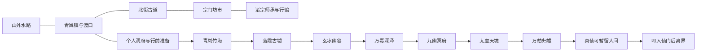
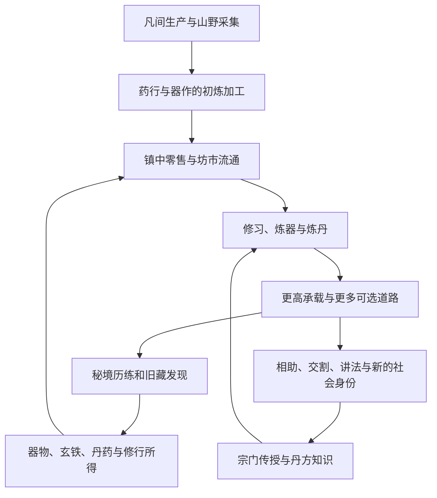

# 叩仙门：青岚纪 · 世界观与叙事设定稿

> 供作者审阅的第一版完整设定。核对基线：`f78e936`。本文补足背景、因果与叙事边界，不表示新剧情、新地图或新机制已经实装。现有序章、终章和固定人物故事保持原文。
>
> **核心命题：一个人可以修到不再被岁月夺走，却不能因此把已经过去的岁月还给所有人。** 青岚不是等待仙人拯救的布景，而是仙人出发的地方，也是后来者仍要生活的地方。

## 阅读导航

- [一、这部作品讲什么](#一这部作品讲什么)
- [二、天地怎样运转](#二天地怎样运转)
- [三、从旧潮到今朝的历史](#三从旧潮到今朝的历史)
- [四、青岚镇与山河的空间关系](#四青岚镇与山河的空间关系)
- [五、修行者与岁月](#五修行者与岁月)
- [六、七境是一部可以走进去的天地史](#六七境是一部可以走进去的天地史)
- [七、人不是系统的说明员](#七人不是系统的说明员)
- [八、十六宗门为什么各有一条路](#八十六宗门为什么各有一条路)
- [九、一个残酷世界如何仍然有集市](#九一个残酷世界如何仍然有集市)
- [十、器物、器式与功法的统一解释](#十器物器式与功法的统一解释)
- [十一、丹道把不同尺度的岁月收进一炉](#十一丹道把不同尺度的岁月收进一炉)
- [十二、奇物改变道路的代价，不包办整条道路](#十二奇物改变道路的代价不包办整条道路)
- [十三、把一生放进时间线](#十三把一生放进时间线)
- [十四、帮助中的山河旧闻](#十四帮助中的山河旧闻)
- [十五、系统与世界观逐项对应](#十五系统与世界观逐项对应)
- [十六、必须经得住的追问](#十六必须经得住的追问)
- [十七、给后续写作者的约束](#十七给后续写作者的约束)

想先判断故事气质，可先读第十四节的完整背景底稿，再读第一、三、七节；要核对设定如何支撑玩法，可从第二、五、十节读起，再查第十五、十六节。本文面向作者，包含终章与后期机缘。已接入帮助的玩家正文见 `src/guide-lore.ts`，按下述第十四节控制揭示范围。

### 设定的可信层级

本文使用四个层级，避免把创作建议伪装成现有剧情：

| 层级     | 含义                                               | 使用边界                                                     |
| -------- | -------------------------------------------------- | ------------------------------------------------------------ |
| 既有事实 | 当前固定正文、实际计算与流程已经确定的内容         | 新背景必须兼容；冲突时先服从事实，不为圆故事暗改玩法         |
| 拟定正史 | 本文提出的天地原理、历史原因、器物来源与人物解释   | 经作者确认选入「山河旧闻」的部分已用于帮助，其余仍为创作依据 |
| 世间传闻 | 镇民、游商、门人能听说却无法证实的故事             | 必须保留讲述者与不确定性，不能拿来担保交易、赠物或神通       |
| 表现约定 | 战斗分钟、暂停、随机选项、存档、模式约束等交互表达 | 说明它怎样服务叙事，不硬编成角色能操纵世界的法术             |

下文的天地史、地理成因、宗门沿革和器物来历，除标明现成引文的部分外，均属于**拟定正史**。数值和开放条件单列为规则锚点。没有现成剧情支持的细节不写成玩家必经事件，也不许 NPC 假称与你共同经历过。

## 一、这部作品讲什么

### 1.1 主线不是找出一个幕后凶手

青岚山下的少年，因为听见“山河之外，还有求长生、问大道的路”而出发。这个愿望足以成立，不需要再补上灭门之仇、天选血脉或注定救世的使命。

他首先想逃开的是凡人的短暂：春天会回来，有些人却不会。后来才知道，长生解决的是自己的寿数，解决不了所有人的离别。修行越深，能做的事情越多；与他一起吃过饭、补过衣、喝过酒的人，却未必有相同的年月。

故事的宏大来自尺度的扩大：一段街巷、一代亲人、一座宗门、一轮灵潮、一方天地。故事的落点始终很小：有人在渡口问路，有人愿意多坐一会儿。

### 1.2 三条互相牵引的线

**求道线**：识灵根，入竹海，积累道基，理解不同器法，经历诸境，最终通过归墟试炼。它回答“怎样活得更久、走得更远”。

**入世线**：修行需要物资、知识、交换与他人的劳动。少年从求助者成为有资格办事的人，也可能在不对等交易中受辱、被骗，或者在险约中丧命。它回答“力量如何改变一个人在世间的位置”。

**归乡线**：亲人老去，铺面换主，旧识留下信，后来者有自己的生活。它回答“走得越远以后，还认为什么值得回来”。

三条线不互相设通关门槛。可以不结道侣、不入宗、不做镇中故事，照样成仙；这些经历改变一生的内容，不充当必须缴纳的善行税。

### 1.3 世界的残酷与温度都必须有对象

残酷不是到处随机杀玩家。它来自有限寿元、天资差异、资源稀缺、实力悬殊，以及离开公开秩序后真实存在的恶意。温度也不是做件好事就必得仙丹；它来自有人把你当作一个会饿、会冷、会疲倦的人。

正道未必善良，魔道未必失信。前辈也可能压价，凡人也能教仙人怎样面对离别。强者的判断可能正确，但其境界不替他证明品德。

### 1.4 最终希望留下的感受

终章不揭晓“一切都是梦”，不否定已经失去的人，也不让少年变成上一位仙人的备用身体。前人确实走过，后来者确实开始。能留下的一句话、一件东西，只是帮助；后来者要面对的风雪仍是自己的。

## 二、天地怎样运转

### 2.1 一方天地，四种不同的东西

为避免把所有机制都归结为一个含混的“灵力”，设定采用四个基本概念：

| 概念 | 是什么                                                     | 在游戏中的主要对应                     | 不是什么                             |
| ---- | ---------------------------------------------------------- | -------------------------------------- | ------------------------------------ |
| 灵机 | 天地万物可以被生灵与器物引动的活动能力，有浓淡、属性与流向 | 灵气、五行、术法、灵石                 | 杀死任何东西都必得的通用积分         |
| 道痕 | 灵机长期运行留下的结构与规律；可以附在山川、器物、身体中   | 功法、炼器纹理、古阵、地域招式         | 一个保存所有死者人格的全知记忆库     |
| 道基 | 修士把所学、所受与所炼真正变成自身秩序的结果               | 永久修为、境界、根基、部分本世药效     | 一场战斗里暂时借来的全部力量         |
| 岁律 | 此界生命、物质与因果共同向前的次序                         | 总年岁、寿元、药效、故人换代、周期天劫 | 能用界面暂停或关闭浏览器钻空子的法则 |

人有身、有神、有承受变化的能力，因而能修行。灵根决定天生纳灵与协调五行的效率；道基决定最终能留住多少。这个体系允许资质很差的人修仙，也允许资质很好的人死于一次错误判断。

### 2.2 灵潮：为什么恰在此时秘境重开

灵机不是从一座矿中永久匀速涌出。它沿大地、山川与更深的界隙流动，长久积蓄后向外回涨，形成跨越许多代人的灵潮。退潮不是世界完全失去灵性，而是高阶灵机变薄、旧通路难以稳定、许多大规模修行活动变得不合算。

今朝的灵潮重新抬高了这些通路的承载力。原本沉寂的遗址、谷地、泽国与高空界隙渐渐可入；潜伏其中的生灵与古阵也得到滋养。山门重开与妖雾复起是同一变化的两面。它既带来上升的机会，也带来争夺与死亡。

这解释现有序章的“如今灵潮再起”，但不增加一个倒计时世界事件：游戏没有要求若干年内通关，否则灵潮关闭。退潮和涨潮属于宏观史，不用来事后抹除玩家的已开放入口。

### 2.3 五行是运转方式，不是七张地图的颜色表

金偏收束、锋锐与定形；木偏生长、牵引与延展；水偏流转、涵养与渗透；火偏释放、转化与焚化；土偏承载、镇固与聚合。

这五类描述的是器法怎样组织力量，不把每件物品按外观机械分类。雷可以表现为金火等灵机的剧烈释放，冰可以表现为水机凝滞；毒往往是生化失衡，魂术针对神识联系。**冰、雷、毒、魂都不是现有灵根盘之外新增的属性。**

异灵根也仍在金木水火土中取一种。其“异”解释为纳灵通道有少见的形态或稳定方式，不能直接套成游戏没有的冰灵根、雷灵根、风灵根。

### 2.4 灵根不是人的贵贱

灵根是一种先天条件，不是天道给人格的评分。单系通道容易同调，因而天灵根进境迅速；多系能呼应更多种器物，却需要承担更多协调。无灵根不是没有神魂、无法碰触法宝，而是缺少稳定的先天捷径，仍可借器式、炼养与积累开路。

镇上有人认为“没有灵根就去不了仙山”，这是凡人的常识与生计判断，不是世界绝对禁止无灵根修行。凡人选择种田、掌船、教书，也不等于其一生失败。游戏中的凡骨登仙应是艰难可成的路，而非叙事上被先宣布不可能、随后依赖主角特例翻案。

### 2.5 为什么山中有古物，街市却没有遍地仙器

灵机浓度、保存条件和运用方法缺一不可。古器能在封闭遗址中留存，不等于被拿出来的人都知道怎样长久驱使。某些旧物只是器式传承，某些本体有缺损，某些在当时灵潮下才能完整展开。

器物的价值由可用性、祭炼程度、知识和买家的需要共同决定。名称叫“钟”“鼎”“幡”不代表天下只有一个实物；称作仙器也不代表持有者已经证得真仙。器物境界与人物境界不能混为一谈。

### 2.6 神魂、残念与死者的边界

生命消散后，受强烈灵机作用的情绪、术法痕迹或未散灵性，可能暂留于物或地。九幽之“魂”首先属于这种异常环境，不是整个人间死者都必须报到的行政冥界。

残念不等于完整的人。记录一句话，不等于留下说话人的未来；一段魂影有攻击性，也不证明它保有生前全部记忆。收服、击散或拘取这些东西，不能让玩家把父母、道侣和旧友重新拼回原样。

因此，家书与旧物依然不可替代。它们承载的是当事人亲手留下的有限话语，而不是随时能更新的灵魂投影。

### 2.7 仙门之外有世界，但不预写第二部

固定终章已经确认“此界圆满”与“大道无涯”。拟定上界并非此界豪华坊市，而是岁律与灵机承载方式不同的天地；真仙能以自身道基保持完整，才具备离界的条件。

这仅回答为何需要仙门、为何成仙还可以继续求道。当前没有上界地图、仙界货币、返界系统或更高境界表，本文不把这些写成已开放玩法，也不承诺前人下一世会回来救场。

## 三、从旧潮到今朝的历史

### 3.1 历史使用相对时代，不伪造统一公历

游戏记录的是这一位修行者从十五岁起的年岁。现行系统没有跨世世界年、王朝更替表和各宗建宗年份。本文采用可延续数百代的相对时期；它们确定先后与因果，不硬填“某皇朝第几万年”去撞上实际存档。

| 时期     | 主要变化                                           | 给现世留下什么                       | 当时的人付出什么                             |
| -------- | -------------------------------------------------- | ------------------------------------ | -------------------------------------------- |
| 开脉之时 | 先民发现某些山川能助人炼养，零散经验变成可传授方法 | 基础纳灵、五行器式、择地而居的经验   | 早期修法不稳定，长寿者少，许多方法随人而失   |
| 盛潮之世 | 灵潮旺盛，修士组织大规模铸器、炼丹与跨域探索       | 古墟、器谱、道纹、相互通达的修行道路 | 对浓烈灵机的开发超出局部承受，事故与争夺增多 |
| 诸法分流 | 同一修行目标出现不同代价选择，师承渐成各宗         | 正魔法门、本命与配套、专门技艺       | 无法让所有人同时得到更快、更稳、更便宜的修行 |
| 长退潮期 | 高阶通路沉寂，维持广阔山门比占有它更昂贵           | 残留古阵、封存器物、部分失传工艺     | 不少修士退出远境，留守者在有限资源中衰老     |
| 守渡诸代 | 山下水路与寻常生计继续，修士与凡人重建稳定交换     | 青岚镇、街市、行馆与守约的习惯       | 凡人一代代修桥、护岸、续铺，名字却少入仙史   |
| 今朝复潮 | 旧路重通、妖物活跃、山门和魔宗陆续恢复             | 玩家可参与的秘境、宗门与坊市         | 机会与风险同时增加，旧知识未必足以应对新局面 |
| 此世之后 | 有人倒下，有人成仙，有人只把一门手艺传下           | 家书、器物、留影、后来者的路         | 前一人的成就不能替后来者经历一生             |

### 3.2 盛潮没有一个负责全部灾难的恶人

旧时修士确实把一些地方改造成便于修行的环境：火阵使炉火长久不息，寒地封藏灵物，毒泽用于辨药，魂术用于研究神识，高天阵枢试图稳定界隙。各地的自然条件和人为改造相互叠加。

退潮以后，不是每一座阵都及时停下。有的失去维护，有的只剩局部运行，有的被生灵占据，有的本来就从未完全受人控制。今日七境的危险由不同历史造成，不能统统写成同一恶神投下的七个副本。

落霞的余火、幽谷的封藏、深泽的失衡可以互为同时代遗迹；九幽与太虚则伸向更深层的道痕与界隙。历史关联不等于玩家必须找到七把钥匙才能开门，现有推进仍以实际通关为准。

### 3.3 正魔分流发生在方法上

早期修士面对一个共同难题：有限寿数能否支撑缓慢筑基。有人选择降低反噬、逐层稳固；有人选择把痛楚、衰损或危险移到自己愿意承受的地方，换取更强的即时能力。

长期形成了正道与魔道两类师承。正道也会因稀缺资源而争，魔道也要教弟子、守契约、买药材。其利益与日常生活不允许世界只剩两支永远互杀的军队。

散修可以兼修，把不同法门配成自己的路；宗门则要求入籍者遵守完整传承，以便教学、资用与考校。退出一门不抹掉所学，但不再享有该门持续提供的精研支持。

### 3.4 青岚为何能比一个修士活得更久

青岚的连续性不靠每块砖都千年不坏，而靠道路、水源、码头与地理位置始终有用。屋顶会换，掌柜会换，渡口也会重修；后人沿用地名，是因为这一处仍值得住下。

它没有必要成为统治全世界的都城。一个足以连接河运、山路与修行商贸的节点，就能让不同来路的人在此短暂停留。万年仙人眼中的“还是那座镇”，由许多个凡人的整整一生共同维持。

### 3.5 今潮为什么容得下一个十五岁少年

秘境重开带来失落的器式，也带来大量需要劳力与知识的外围事务。凡人家庭不必拥有灵脉，孩子也不必通过皇朝选拔，才有机会接触一个问路的修士。

那位过路人提供的是方向，不是包办一生的师父、跨界系统或保证登仙的契约。少年出发后仍要面对随机资质、两手有限的物资和陌生人的态度。序章的轻盈因此保留下来：他先迈步，才知道自己要付出什么。

## 四、青岚镇与山河的空间关系

### 4.1 可用的地理骨架

以青岚山下河谷为人间锚点。青岚镇沿河而建，码头承接山外来往，北街古道通往宗门坊市；洞府属于个人静修所在，藏器阁与丹囊属于个人修行管理，不凭界面存在就新增两座公共建筑。

青岚竹海是从人间进入浓烈灵潮的第一层。其后各境沿旧修行通路与逐渐加深的界隙展开，未必是从南到北紧挨着的六块土地。山河图是旅程关系图，不是等比例交通地图。

箭头表达玩家的开放次序，不规定必须由上一张战场步行到下一张。镇坊通路是已经实装的连通；更广阔水路、历史聚落与界隙成因属于背景。

### 4.2 青岚镇先是生活的地方

九类职业共同维持聚落：百草堂处理常用药物与采药，听雨茶馆交换见闻，青岚镖局接续交通，货商转运灵材，匠人修器修钟，裁缝照料衣食，农人供养街市，渔夫撑起渡口，游学者记录所见。

这些人可以使用修行社会认可的灵石计酬，并不因此人人都有法力。凡人对灵材的采集、辨认、打磨、运输和保管，都是修士体系所需的劳动；货币能交易，不要求使用它的人亲自把它炼进经脉。

小镇出售凡品药、零批玄铁，适合刚出门和临时补缺的人。它的规模不必随主角境界自动膨胀成仙界商都：修士会去坊市寻找更复杂的货，凡人的铺子仍服务大多数街坊。

### 4.3 坊市为何在镇外而不吞并小镇

坊市承接的是另一种停留：验方、议价、鉴器、行馆往来、公开竞宝。它需要更大的交易空间和相对明确的行规，也不适合把毒物、灵压与高阶器具长期摆进凡人的窄巷。

两处因此相近但分工。修士可以在镇上吃茶、买衣、见亲人，转过古道再办修行事务。小镇不只是低级坊市，坊市也不是青岚镇升级后的替代界面。

### 4.4 门槛与道路

游戏中获得第一份永久修为、踏入炼气后才开放坊市。拟定解释是有了基本引灵能力，才足以辨识修士交易所需的器纹与交割尺度；不是一道会把无灵根人烧死的门。

镇坊门楼是普通通路标志，不应把门楼写成强制缴费阵、单向封印或新秘境。两边快捷往来也只是同一段来往的省略呈现，不带来额外收费与时空穿梭收益。

### 4.5 洞府不是人间的反面

洞府可以理解为修士安置身体、整理物资与校准法门的静处。它让刚刚获得的力量成为可用之物，却不能凭一扇关门把世界冻结。闭关、修习、炼丹所过去的年岁，仍会在故乡的瓦上留下风雨。

一位后来达到真仙的人仍可在叩门前回镇、办事和继续修习，说明成仙不自动删除社会联系。真正不可回头的选择发生在叩入仙门之后。

## 五、修行者与岁月

### 5.1 人为什么能修仙

人的身体本来就在与天地交换：呼吸、饮食、感知、学习都让外物成为自己的一部分。修行是把这种过程从无意变成有序，使灵机不再仅仅穿身而过，而能被身与神共同承载。

最初的纳灵十分不稳定；一次强大的灵气灌注可能很快散去。修行者反复承受、理解并重组它，才留下道基。所谓永久修为，是本世身体与神识真正完成的改变；所谓突破，是这种改变足以维持新的稳定结构。

这不是单纯吃进能量就自动变成神。灵根影响效率，法门影响组织方式，器物帮助引导，根基承受输出，历练迫使修士在真实变化中校验所学。任何单独一环都不能无条件替代其余所有环节。

### 5.2 两种修为为什么同时存在

**局内灵气对应当次可调用的周天。** 秘境中的灵机被妖物、古阵和地势束成可吸收的结晶，拾取后能更快搭起器式、维持更多招法或加深某一套运转。离开这次灵潮环境，需要重新建立当次运转，所以新局从基础状态开始。

**永久修为对应真正消化的道基。** 斩妖时的运用、升级时的领悟和通关时的完整体验，会使一部分变化成为自身能力。它不会因为某一场运转结束就消失；足够时可以在战斗中直接突破。

离场不是突然忘记剑诀，未收藏法宝在局内出现也不是凭空把镇上实物偷来：秘境允许凝聚和运转该器的器式，收藏则意味着得到能长久持有、祭炼、设为本命或交易的实物与传承。已有祭炼提供稳定的器式参照，能够增强当局对应法宝。

这一解释不把临时法宝说成没有真实伤害的影戏，也不让当局领悟自动变成一件可带回出售的实物。

### 5.3 为什么击败妖物有收获，杀凡人没有修炼捷径

秘境妖物长期聚纳当地浓烈而失衡的灵机，其死亡使结晶与被压住的器纹显露。修士同时从真实的御器和应变中形成道基，收益因地域深浅而异。

这里没有“生命本身就是经验货币”的普遍公理。普通镇民没有秘境那样的凝聚条件，游戏也没有杀镇民、刷人命、夺舍亲友的行动。劫修遭遇的战利品来自对方实际携带的财物，不能自行追加“杀修士必吸走全部境界”。

妖王收益更多，可以解释为其凝聚了更完整的地域结构，击败时能获得一次完整的理解。首通额外收益是首次贯通的结果，不承诺重复同一境永远获得相同的新认知。

### 5.4 境界是一种承载结构

以下含义为拟定解释；境界名称、顺序和寿元按现行数据。不能把它们写成已经增加了新的被动技能。

| 状态 | 内在变化                                 | 在人的生活中意味着什么                           | 当前基础寿元     |
| ---- | ---------------------------------------- | ------------------------------------------------ | ---------------- |
| 凡人 | 尚无可稳定留存的道基                     | 从十五岁启程，未知资质不等于没有出路             | 以初始寿限规则计 |
| 炼气 | 能将外来灵机纳入可反复运转的脉络         | 第一次真正进入修士的交往与交易                   | 100 年           |
| 筑基 | 把暂时周天固定为可靠道基                 | 有能力规划超过一代凡人的修行，仍须精打细算       | 250 年           |
| 金丹 | 多股运转归于内在核心，输出与回收更完整   | 承担交割、见证等责任，开始看见熟人变老           | 500 年           |
| 元婴 | 神识与道基形成更独立的内在组织           | 能理解身体以外的复杂变化，但没有自动获得夺舍玩法 | 1000 年          |
| 化神 | 神识与外界灵机能作更细致的应答           | 可讲法、调停，力量逐渐成为社会信用的一部分       | 2000 年          |
| 炼虚 | 开始理解器法之间的空隙和界隙的承载方式   | 更依赖长久专长，不能只凭抢得一件宝物补完认知     | 5000 年          |
| 合体 | 身、神与道基不再各自牵制                 | 凡俗寿命已短得难以比较，仍会受伤与死亡           | 10000 年         |
| 大乘 | 自身循环足以抵住自然衰朽                 | 不再有自然寿限，却仍受此界周期天劫约束           | 无自然寿限       |
| 渡劫 | 已到成仙修为门槛，尚未完成归墟试炼的称谓 | 是临仙关前的状态，不是另一套初中后期             | 按大乘规则       |
| 真仙 | 完整道基通过归墟验证，能够承受离界       | 周期天劫止息；可暂留，也可叩门                   | 无自然寿限       |

炼气至大乘各有初、中、后期。渡劫与真仙不另分三小阶。称“元婴”不能自行加上丢失肉身继续玩；称“化神”也不能推导全地图读心。境界含义解释现有力量，不偷渡新操作。

### 5.5 一条真实岁律，几种呈现尺度

秘境越深，灵机与道痕的结构越复杂。追索、沉潜、温养与真正的交锋交替发生，一次看似接续的御器，背后可能隔着很长的调息与适应。身处其中的人，回想这段经历时，最鲜明的是几场交锋与几个领悟的瞬间；身体所承担的岁月、外界所经过的岁月却都没有免除。**境中像一段交锋，归来已是多年；这多年也算在自己身上。**

同时，画面的一分钟不是世界里所有人物手中的同一只钟。战场把修行、追逐和交锋集中呈现；镇上把行走、驻留和经营压缩呈现；闭关与炼丹则直接略过明确的多年过程。三种呈现不同，最终都落到这一世真实增长的年岁。

因此，本稿不另设“身体只过一日、外界却过百年”的时间倍率。秘境之异，在于能够把许多年的炼养与道痕变化汇入一段密集的求道经历；屏幕呈现其关键片段。灵机越深，完成这一段经历所需的真实春秋越多，收获也越厚。当地没有绕开岁律的免费长生空间。

| 场景             | 当前呈现中的计年    | 背景解释的约束                                     |
| ---------------- | ------------------- | -------------------------------------------------- |
| 青岚竹海         | 每战斗分钟 10 年    | 初入灵潮，已经不是短途郊游                         |
| 落霞古墟         | 25 年               | 旧阵牵动的岁序更深                                 |
| 玄冰幽谷         | 50 年               | 封藏不等于让入境者停止老去                         |
| 万毒深泽         | 100 年              | 生灭轮替极密，药效同样消耗                         |
| 九幽冥府         | 200 年              | 神识感受到的短促交锋不能作为外界日历               |
| 太虚天境         | 500 年              | 接近界隙，完整的修行年月被集中呈现                 |
| 万劫归墟         | 1000 年             | 最深的此界试炼，不能当作无成本刷宝房               |
| 实际镇坊游历     | 每前台游历分钟 1 年 | 代表一段停留，不是说凡人走十步真要一年             |
| 炼丹、修习、办事 | 按事项直接扣年岁    | 代表已经度过这段工夫，无须现实等待                 |
| 周期天劫         | 不计年岁            | 独立迎劫段不推进其他计年；不能延伸为所有雷境都停时 |

“人间账期”只统计宗门所约定的人间驻留、事务及有关活动，不是另一个宇宙的时间。秘境与普通闭关不推进供奉账期，却仍会让亲人老去、药效消退。可将这种约定解释为宗门对在外历练与自行闭关的供奉安排，不宣称修士能暂停全世界经济。

对数值的严格边界：暂停、选技、阅读弹窗和离线不推进这些模拟计时。这是玩家操作的照顾，不能写成主角会让全世界停下等待自己读书。

### 5.6 长生、天劫和仙门分别解决什么

大乘解决自然衰老，却未解除此界对强大独立道基的周期考验。拟定天劫是个人道基与此界承载之间的矛盾显现：越久越强的自成循环，需要一次次证明仍能保持完整。它不是宇宙查账员按善恶发来的罚单。

当前大乘以后、通终关之前，每两万年迎一次独立天劫。每次成功留下劫印，下一次更难。归墟则是另一条完整验证：把此前各种不同的环境压力合到一处，最终通过执劫仙尊的试炼，成就真仙。真仙仍可在此界生活，但不再受这一周期约束。

必须区分三件事：太虚天境里的太虚劫灵是地域妖王；万劫归墟的七劫是终境试炼；两万年一次的天劫是大乘周期事件。难度名称“天劫降临”也不是自动额外生成上述事件。

### 5.7 普通与极限不能写成两套互相矛盾的宇宙

普通秘境中倒下，未必结束此世；按现有操作可继续或结算回去。寿尽、未能渡过独立天劫、坊外劫修身陨等，则有各自的落幕流程。不能写“所有失败都是轻伤”，也不能写“一进入秘境，倒下必定删除这一生”。

极限的“大道无情，生死有命”表达这一生不取战斗退路与额外续命照顾，正常买卖、服药和修炼依然成立。它不是拒绝人与人相助、拒收家书或禁止所有资源的苦行宗教。

现有有限复起与普通补给属于模式提供的操作保障，不拿它们发明死者复生的普遍行业。彻底落幕后的亲友和主角不能靠某件常见丹药重回同一人生。刷新中断的惩罚、暂停规则与难度选择放玩法说明，不让 NPC 讨论网页和按钮。

### 5.8 闭关为什么不能替代全部历练

闭关能整理已有经验，也能从稳定环境中缓慢纳灵；缺少新的压力与结构时，短闭关未必有所得。投入大量寿数后，仍不保证超越一个完整大境界，这使“去看没见过的山河”有实际意义。

到大乘及真仙，普通闭关已经不能提供新的修为与属性，只代表停留。把它解释成等待、整理与自处即可，不许写成成仙后可以无限挂机积累战力。

## 六、七境是一部可以走进去的天地史

七境可形成一条内在顺序：**生长、营造、封存、腐解、留痕、校验、汇归。** 这是理解不同生态与遗迹的线索，不是新加的属性克制表，也不要求玩家读懂它才能通关。

### 6.1 青岚竹海：力量最初从寻常之物中长出来

**既有锚点**：古道、竹海、山灵、苍木妖王；菇妖、狼狐、龟与树卫共同出没；藤枝会封路，狼群会侧向收拢。

竹海处在凡人熟悉的山路与浓烈灵潮之间。外沿的采药与樵作让青岚人知道山的脾气，深处的旧路却不是靠一双好鞋就能走通。树根沿灵脉延展，菌群消化落叶，兽群以气息分辨领地；灵潮回升以后，这些普通关系渐渐变成术法。

苍木妖王拟定为根脉深处主导灵性凝成的王躯。藤枝围路、荆棘散射、山灵应召，都源于它与周围生长的联系。它不像一位坐在王座上治理森林的国王，更像整片生机在某一处结出的危险意志。

通关是击破眼前王躯、踏通一段此前不能理解的山路，不是把竹海全部树木连根拔去。首次贯通所得丰厚，也可解释为少年第一次真正让外来灵机成为自身道基。

**人物尺度**：这一境最容易出现“出门时以为几日，归来已经多年”的第一次错愕。不要强制安排父母死亡提示；允许玩家实际返回时，自己发现他们的变化。

### 6.2 落霞古墟：人曾经用过这股力量

**既有锚点**：古阵余烬、离火未熄；铜龟、陶俑、戟卫与祭师；赤炎狐王以火扇、火径与错时炎路追逼。

拟定古墟曾是多代修士经营过的炼器与丹材集散地。这里并非一夜造就的帝国首都，而是围绕稳定地火逐渐扩展的聚落：先有炉，再有储藏与守卫，最后才有被后来人统称为古殿的建筑。

退潮后，维护者或迁走、或断代。炉火失去了完整调度，却没有完全熄灭；残阵仍会点亮，陶俑仍会沿旧职责行动。狐类适应了火径，把过去的运输巷道变成自己的猎场，赤炎狐王由此长成。

火球命中后的短促灼烧可解释为余烬滞留，火径则是阵路先被引燃、随后封住落脚处。这里让玩家面对的不是另一种颜色的弹丸，而是旧文明的路还在“工作”，只是已经不再为人服务。

**边界**：不保证古墟必掉某一件指定法宝，不新增熄灭总炉、修复王城或殖民遗址的任务。旧器可以流到今天的坊市，但不是所有货物都必须来自此处。

### 6.3 玄冰幽谷：想把珍贵之物留住，未必能把人留住

**既有锚点**：千载寒霜、寒铁傀儡、雪魄镜妖、霜狼与鹤灵；霜魄狼王连续扑击，冰棱错时长出。

谷地的寒脉原本就有收束灵性的条件，古修后来借它封藏易散的药性与器纹。谷中既有适应寒冷的生灵，也有留下来维持封藏的旧器，二者不是同一种来源。

寒铁傀儡靠明灭的护持维系残余职责；镜妖源于长期映照灵机的器物；狼群则在狭窄而可预测的路径上猎食。霜魄狼王不只靠更冷取胜，它懂得让群猎节律与冰棱成形的时差配合，使迟疑成为危险。

这一境的主题是保存的限度。某件器物可以在寒中留下，进入谷里的人却仍要承受年岁。不能写玩家把父母放入冰谷就能等待自己成仙；游戏没有这项能力，也不以这种办法撤销离别。

### 6.4 万毒深泽：被舍弃的东西仍有自己的去向

**既有锚点**：瘴孢、蛊群、毒蝎、蟾蜍、蛇母；小怪游移瘴云、死后毒囊，玄甲毒君驱动游瘴与毒息。

深泽接纳周围山地的腐殖、沉积灵质和部分古修废弃之物。它不是一个只为表现邪恶而存在的污水坑，而是旧结构被分解、重新混合的地方。某些成分在丹炉里是药母，在混杂的泽中却是毒；剂量、配比与归属决定用途。

其生灵把“不能让对手久站一地”变成生存方式。瘴云会游移，孢囊死后仍留下危险，蛊群把猎物推向不干净的落点。玄甲毒君以厚甲和自身毒息承受这些混杂灵机，不必具有统治天下的野心，也足以令人丧命。

**边界**：毒害来自实际技能与区域，不是进图后全地图自动扣血。击败妖王不会永久净化湿地。丹药抗毒也不等于能够免疫所有火、魂、雷或接触伤害。

### 6.5 九幽冥府：痕迹会回答，故人未必在那里

**既有锚点**：魂火、骨卒、刑卫、引魂灯使、无面幽魂；魂线、随控制者消散的护卫、冥主换位与假影。

拟定“冥府”是修士给这片幽暗灵域的称呼。这里聚集失主器灵、旧仪式的残余命令、未散的情绪与魂火。它们能构成形体和敌意，却不因此构成一套统管死者的朝廷。

九幽冥主擅长维持联系、剪断联系，也擅长用相似的形象误导来者。魂弹短时扰乱修士与器式之间的御使关系，因此可能暂时封宝，却不妨碍人继续走动，已经施放的攻击也不会被倒收。魂线上的护卫依附控制者而存；冥主另造的假影一击即散，没有正常妖物的收获。

**核心限制**：残念可留，完整人生不能因此被复制。这里不是寻回父母的隐藏入口，不许用未实装的招魂承诺诱导玩家。愿意珍惜故人的人不需要先“斩断七情”，才能通过这一境。

### 6.6 太虚天境：强大之外，还有准确

**既有锚点**：雷路、雷痕、星环、金甲天将、太古钟灵与太虚劫灵；两道雷路先后生效，近处突袭留下雷痕。

天境位于更接近界隙的高层灵域，旧修曾在这里布设渡界与校准阵枢。古器失主后仍按自己的节律运行，游离灵性则在强烈的雷流中凝形。

名叫天将、星君，不等于这些妖物已经各自证得真仙，更不意味着玩家正在攻打有明确官籍的天庭。称号来自形貌与旧制印记；当代修士并未看清全部历史。

雷阵的威胁不只是伤害：先后落雷、短暂禁锢和突袭落点，迫使人辨别时机。击杀施法者可以使其所维持的雷阵消散，也体现阵势需要实际来源。雷麻期间仍可施法，与魂弹封宝恰好形成相反的短板。

**边界**：并非一切雷招都带雷麻；当前相关小怪雷路与雷痕有禁锢，旧王的其他雷印和独立天劫按自己的规则。不把“雷劫淬身”的题记写成此境自动赠一枚周期劫印。

### 6.7 万劫归墟：不是忘记前路，而是同时承受它

**既有锚点**：全员精英；六位旧王依次登场，最后是九天执劫仙尊；可以双王同场，七位全部击败才通关；旧王保留原招并追加地域招式。

拟定归墟是诸潮与道痕汇聚的深层节点。前六境各显一面，在这里则互相牵引。曾以为已经学会的处理方式，放到另一个危险同时出现的局面中，未必仍然够用。

这里凝成的六王称为**劫相**：对应各境长期留下的主导道痕，具有真实灵机、真实伤害，也能留下真实收获。它们不是把已杀过的六具尸体送来复活，更不是无害的记忆录像。更完整的道痕容纳旧招与新招，因而熟悉又更难应付。

九天执劫仙尊拟定为古老渡界法统留下的**执劫法身**，负责把分散的承载试验合成最后一次问劫。其原身、最初立法者和更早的来历暂不确定。法身不是一位统治所有玩家人生的全知神，也不负责判断你属正道还是魔道。

六种仙尊招式——诛仙雷轮、五方劫雷、八荒封天、天罡剑潮、金阙天兵、踏云雷袭——可读作环绕、落阵、封域、穿透、召兵与追袭的集中检验。通过不是杀死全宇宙唯一的至高者，而是自己的道基经得起这套问劫，因此获得真仙之实。

**边界**：不要求先达到大乘或先渡五次周期天劫才能挑战；正常解锁后即可尝试，获胜时修为不足会补足成仙门槛。归墟不掉回血丹，宝匣也不回血，但不禁止已经持有的恢复能力。仙尊最早在 5:30 出场，不代表 5:30 强制结束；最后存活的也未必是仙尊。

### 6.8 重游为什么不抹掉上一次胜利

同类妖物属于持续存在的群落，旧阵能被后续灵潮再次驱动，地域主导灵性能重新凝成王躯。修士上一次击破的是一次阻碍，不是使整片山河永远失去生机。

王躯、器灵与归墟劫相有不同于人类个体的存续方式；这项解释只用于相应存在，不能反过来宣称已被击杀的劫修也能换批回来，或者父母死后总会在同一铺面重新出现。

具体多少秒刷怪、同时几只、每王最多三件新收藏，是玩法对遭遇与有效发现的整理。世界里没有规定每位妖王都背着三个同尺寸格子的行囊，也没有把每秒所得灵石当作天道薪俸。

### 6.9 旧藏与守匣为什么不另起一条主线

六境守匣灵阵可以解释为不同地域保存旧藏的方式：竹海护阵借根系，古墟封路借余火，寒谷守藏借冰棱，深泽以瘴孢遮护，冥府维系主从，天境利用雷印缺环。

守卫是这一次护阵的组成，击破并不额外产生完整妖物的经验与掉落。宝匣属于机会，可以走近自动参与，也可以略过；它不是主角答应过某位祖师、忘做就背叛天下的任务。

## 七、人不是系统的说明员

### 7.1 主角：只有来处，没有被指定好的结局

主角确定的来历是青岚镇与十五岁的启程。姓名、灵根、路线、本命、拜门与结缘都留给这一世发生。本文不添加固定仙骨、秘密家族、前世帝尊或“其实父母不是亲生”的反转。

主角可以求快，也可以在安全处积累；可以信人，也可以核验与拒绝。他不是必须完成某种道德测验才有资格离界的故事工具。玩法允许的不同一生，背景必须都容得下。

### 7.2 父母：让世界的尺度从一句叮咛开始

母亲要他添衣，父亲要他把自己选的路好好走，家人盼他有空回来。他们不需要知道九天执劫仙尊的来历，就足以成为整个故事最早的坐标。

父母有自己的年龄与寿终时点。进境不会把他们变年轻，长久不回家也不会让他们一直停在家门等你。亲人都离去以后，家书才在故居里等待被发现；故居甚至会在更久之后由其他人住下。

父母看见“你还是走时的模样”，是对外貌的观察，不是凡人识破了元婴化神。写亲人应多写吃饭、添衣、屋瓦、门口与近况，少让他们像教程一样解释战力。

**不可代写的解决办法**：当前没有给父母服丹、替其改根、替其承担天劫的功能。背景不承诺主角本来能救却被剧情强迫不救，也不把他们的死亡解释成天道索取登仙祭品。

### 7.3 最初的过路修士

初代序章只称他为过路修士。其境界、宗门与姓名未确定，应保留这份距离。少年得到的是“路存在”的消息，不是全知导师给出的最优通关规划。

承缘开局则不同：此时的过路修士明确是上一程已证长生、即将离界的人。相同的指路话可以由不同的人说出，不必用时间循环把他们强行合成同一个人。

### 7.4 三代铁匠：《炉火未凉》

旧钟用来让雾夜的归船知道岸在哪里。有人出玄铁，有人留下拉风箱，两种帮助都参与了凡人的生活。下一代依据账册和遗信续上旧事，旧钟可以留在渡口，也可以送往学堂。

最后留下的炉火旧铃不是神器。它的珍贵在于三代人都记得一件小事有人帮过忙。少量玄铁回礼属于实际结果，但不能把故事解释成投资两枚铁以后必赚几枚的理财项目。

这一线承担“共同生活怎样延续”的功能。传人不继承先人的全部私人记忆，他们能知道什么，来自旧信、手艺与讲述。迟归者可以通过这些东西续上故事，不能被叙述成亲眼见证了自己错过的每一代。

### 7.5 布铺、江船与书箱

| 旧事     | 这个人自己的愿望                           | 玩家可以参与什么                     | 不应把故事变成什么                               |
| -------- | ------------------------------------------ | ------------------------------------ | ------------------------------------------------ |
| 檐下春灯 | 开铺、种花、照料学徒，也希望有一段共同生活 | 成年后主动选择道侣或知己，再回来共坐 | 必须完成的婚姻、自动续命、属性增益或仙人专属侍从 |
| 江上故人 | 想见大江，也牵挂家和渡口                   | 劝远行或守渡，两种人生都成立         | 只有走出去才算成功，留下就是坏结局               |
| 纸上远山 | 分清亲见与传闻，把山那边记下来             | 赠言、倾听，支持授业或游历           | 另一个必然觉醒灵根的救世少年                     |

《纸上远山》的初逢书生是十八九岁，终章承缘者是十五岁。两人只在“问路”这个动作上呼应，不是同一人物，也不默认是玩家后代。

这些人的书信应承认其生活不止等待主角。他们会做选择，会遇见旁人，会过完属于自己的有限人生。没有结为道侣也不删除那段情意，没有收到战斗奖励也不表示没有得到东西。

### 7.6 温照川：修仙者也可以把一生留在一盏炉火旁

温照川是固定姓名的守炉丹修。他并非为解释炼丹按钮而临时出现的人：他有留坊安炉与外出访药的犹豫，也会因时间、选择和自身修行迎来进境或寿尽。

初识五年后，玩家可以给建议；选择十年后，再听见这一程的结果。留下来不等于停滞，远游也不保证登仙。其药册侧重封签、药性与凭据，路书侧重接应、临时变道与退路，所得是判断线索，不是免骗免死的护符。

若玩家回来太迟，温氏后人和旧信接过讲述。后人可以念先人的话，不能冒称自己曾与你同行。高境界信息也只在玩家确实能分辨时呈现；低境界读者看到的是丹修或前辈，不是后台设定表。

### 7.7 终章的少年

他在渡口，十五岁，行囊很轻，想知道外面的天地多大。他不是没有生活的白纸：同样有这一世的亲人、故居与未走过的路，只是终章不替他写完。

前人可以赠一件法宝、一枚丹药或一件奇物，也可只给指引。给出的实物保留其实际性质；修为、已经服用的药效、所有交情和一整部履历，都不是可以直接塞进袋里的东西。

“只留一样”是这次临别的分寸与玩法选择，不是仙门会烧毁第二件遗物的物理法则。不能以少年承受不了两件奇物解释，因为现行人物确实可以同时持有多件。

他不是前人夺舍，也不是用重生让前人再见父母。离界者继续自己的大道，少年开始自己的问题。这是两条人生在渡口相接的瞬间。

### 7.8 市井高人与说书人口中的远方

市井偶遇的“仙人”来历不明，不按这个民间称呼认定其真实大境界，也不认定为已经离界的上世主角返航。普通坊市来客与这种偶遇不是同一个人物池。

茶馆里不灭渡灯、迟来的灵丹、赴百年旧约的剑修，可以表现人间如何理解长生。这些是说书人的旧闻，听者可以感动、怀疑或想起自己的经历。它们不自动变成三条已开放任务，也不是每件传说中的器物都应出现在藏器阁。

### 7.9 所有人物共同遵守的认知边界

人只能知道亲历、听闻或有能力辨识的东西。弱者看不穿前辈，大境界相同者不因小阶段高低另变成两种物种。境界感知不是读心，不揭示私约真假，不提前知道他人的死亡结算。

旧识知道共同交易，新任掌柜知道传下来的账，母亲知道孩子的习惯，温氏后人知道药册。把这几类知识写准确，比让每个 NPC 都会背世界观更能让世界可信。

## 八、十六宗门为什么各有一条路

### 8.1 宗门保存的是可重复的传授

一个人偶然做到一件事，不等于能教下一代稳定做到。宗门把器谱、练法、场地、验证方法与长期互助保存下来，降低每个人从零试错的代价。它提供机会，也要求入门礼、供奉与遵循本门路线。

常见器式与功法的基本形态已有流传，因此散修也能领悟。宗门价值不是垄断天下所有知识，而是可靠地起步、持续精研和专长分工。否则散修能用功法、兼修能跨两路，都将无法成立。

### 8.2 八种难题，两套解法

以下八对来自现有功法对应关系；术理概括与门庭性格是拟定解释。

| 共同难题                   | 稳健一侧：宗门／功法 | 承担代价的一侧：宗门／功法 | 两种方法为什么能觉醒同一类器物                         |
| -------------------------- | -------------------- | -------------------------- | ------------------------------------------------------ |
| 怎样把力量送得更足         | 太玄剑宗／太玄剑经   | 血煞宫／血煞真经           | 都能增强驱力，后者以更大的受伤风险换取强度             |
| 怎样缩短两次施法之间的空隙 | 周天星宫／周天星诀   | 天魔宗／天魔解体           | 一者整顿节律，一者压迫自身承载以催动更快周转           |
| 怎样让术法影响更广         | 乾坤道院／乾坤道法   | 九幽门／九幽冥典           | 都能展开器势，后者更善凝滞，但牺牲部分最终伤害         |
| 怎样让身体承受前路         | 金刚禅院／金刚不坏   | 白骨山／白骨魔功           | 一者稳固护持，一者重构骨灵与反击，行动相应变缓         |
| 怎样让力量持续、让自己复原 | 长生谷／长生真经     | 噬魂殿／噬魂大法           | 长养与外摄均能续持，后者更多依赖斩妖所得而损自然恢复   |
| 怎样看准一次致命的空隙     | 破妄山庄／破妄心诀   | 厄运教／厄运咒             | 观察与催生失衡都能成就会心，后者把自己也置于更易受伤处 |
| 怎样把散落灵机纳入周天     | 纳灵阁／吞天纳灵     | 拘魂楼／拘魂秘术           | 一者扩大吸纳，一者强拘近处灵机，后者拖慢施法节律       |
| 怎样更快把所得用于成长     | 紫府仙宫／紫府仙经   | 逆命宗／逆命魔典           | 一者归整内府，一者强推成长与输出，后者承担更高伤害风险 |

魔道的代价真实存在，但不把代价全改写成杀凡人、炼活人。现有法门有自己的阴厉语言与取舍，背景应保留其危险性，也容许具体魔修诚实、温柔或自私。

### 8.3 门庭不是一张只换名字的名册

**太玄与天魔**都重视器谱与实用之器，因而能代寻适合本门、配套或本命五行的法宝。太玄的传统可偏向辨来历、养成己用；天魔更愿研究难以常法驱使的异器。两家都只能提高寻找的条件，不能担保所有失物立刻现身。

**周天与紫府**对时间作不同安排。周天用较高灵石投入换推演效率，紫府以较长静修换较低费用。两者都把“一个人的几年值多少”当作修行的一部分，而不是只有伤害面板才算门派特色。

**金刚、血煞与逆命**允许以更长苦修节省灵石，分别偏向身体与悟道。穷修因此有路，但时间不是无代价货币：寿元、药效与亲人的年岁都会过去。尤其无灵根人物，不能被描写成只需多等一会儿、绝无风险。

**纳灵与拘魂**懂得把玄铁转为特定修习支持。它们没有把铁直接变成灵石的永动机，只提供有材料、有时间代价的置换。

**长生与破妄**一边保存可重复的炼制工艺，一边从样丹辨出规律。长生代炼仍需已知药方和原料，破妄保留样丹也不等于凭看一眼便得到无限成品。知识能传播，生产仍要付出。

**乾坤、九幽与厄运**擅长不同方向的时效丹互通。丹药不必都由持有人亲自炼制；不同需求使交换有意义。本世珍品不进入这种日常互易，不能写成宗门有无限改命库存。

**白骨与噬魂**重视旧物与余丹仍可承担的价值。献器、献丹抵修习费用，是有估值与实际阶数容量的交割；用不完时应保留物品而拒绝办理，不把浪费美化为“考验诚心”。

### 8.4 入籍、离门与兼修的代价

同一时刻只在一门，意味着接受一套完整的教法与组织支持。入门的起手功法只是一重，精研十阶也只是增强运用收益，不直接把所有战斗准备替玩家完成。

退宗后已完成的精研记录保留，本门精研助益停用，可以解释为持续校验、师承资源和运行支持不再提供，而不是神秘禁制抹去记忆。这里保留的是长期精研档次，并非当局功法重数。重新拜入恢复支持，不意味着阶数赠礼可以再领一遍。

散修可选正道、魔道或兼修。兼修得到广度，放弃纯一路的额外优势；不需要另写一项看不见的反噬风险。宗门限制是组织选择，不是证明两类功法在身体上绝对不能共存。

### 8.5 职务与供奉的现实分量

境界改变别人愿意把什么事交给你：早期护送药囊，中期见证交割，后来主持调停或开席讲法。身份称号表达这种位置变化，不虚构玩家已夺位、能调兵、能征税或能发动门派战争。

供奉维护的是在籍互助与世务支持，其当前计费尺度是人间账期。成为真仙免缴，表示一般门庭已不再以常规弟子份额衡量此人，不等于其他店铺必须免费供货。

灵石不足时可以补缴或离门。这里没有自动叛门追杀，也没有夺走已炼身体的惩罚；残酷来自失去支持与时间成本，不凭空添加玩家未被告知的灭口风险。

## 九、一个残酷世界如何仍然有集市

### 9.1 力量不能替代所有劳动

高阶修士能做到低阶做不到的事，却不因此知道每件古物流落何方、每个药商有何余货、每张失传药方的配比。摧毁一个商人容易，摧毁以后仍要找到下一个愿意供货的人。

坊市的基础不是所有人品行高尚，而是长期交换通常比每次抢夺更有利。来往频繁的宗门、药行、器商与散修共同维护公开凭据和基本秩序；他们不必在所有事情上同意，也需要一个能正常交割的地方。

这种秩序有范围、有成本，不依赖一个能秒杀所有强者的隐形保安。出了坊外，身份难核实、接应不可见、退路被控制，暴力才容易替代契约。强者因此可能压价，弱者可以拒绝；愿意为诱人的私约离开公开照应，才进入另一种风险。

### 9.2 物资、知识与年岁怎样互换

其中凡间生产、加工与远路运输是背景供应链，不是新增种田或经营玩法。循环也不是无成本：资源消耗、探路风险、有限寿元、失败和供给周转都在其中。

**灵石**拟定为能稳定储存并计量灵机的材料，因此兼有工艺用途与通货地位。本文不另造上中下品兑换、银行、利息、矿权或通胀系统。

**玄铁**是承载器纹的可靠材料。它贵在稳定和可加工，不需要把“枚”解释成某位仙帝铸造的不可熔化钱币。镇上适合小批补缺，拍卖的人字场则承接更大的批量需求。

**丹方**是知识，买下并不自动得到原料与成熟工艺条件。**寻访**是信息劳动，花钱并不等于物品已经存在于柜台。**奇物估值**是长期用处，急售净收入则取决于眼前愿意接手的人；几种价值不能混写。

### 9.3 坊中各处为什么需要存在

| 场所   | 解决的社会问题                           | 当前可见的参与方式                         |
| ------ | ---------------------------------------- | ------------------------------------------ |
| 丹药铺 | 需要的药与别人有余的药常不在同一个人手里 | 看来客余丹、换物与去处；不同于镇中凡品零售 |
| 法器阁 | 知道器名不等于知道实物在哪里             | 货讯、法宝与奇物寻访                       |
| 拍卖行 | 少数贵物缺少同时在场的合适买家           | 分场竞价、委托出售、明示佣金               |
| 论道院 | 经验与知识需要可靠的交换场合             | 交流、抄方、互授、较高境界后的讲法         |
| 执事堂 | 货到了不等于交割无争议，承诺需要人办     | 护送、压阵、调停与相应寻物                 |
| 会客馆 | 私人交情需要重新见面，也需要证据         | 旧识求助、查凭据、调停或垫款               |
| 散修摊 | 没有宗门的人仍需参与流通                 | 现有摊主货讯与求购                         |
| 游商摊 | 地方供应不足，需要远处消息与货物         | 来客与实有货讯，不保证无限新库存           |

论道不是一坐下便自动增加修为；讲法不等于把自己境界复制给听者。会客馆也不保证朋友一定记对账，只保证可以按已有流程核实。这些限制让“知识、交情、证据”有各自的价值。

### 9.4 人字、地字、天字三场

三场按买家常见需要和交割能力分层。境界可以作为默认资历，付费也可取得更高场资格，因此门槛属于制度，不是低阶肉身一进去就会被灵压碾碎的物理禁区。

| 会场   | 通常入席范围                 | 法宝炼器阶数                     | 货物分工                                               |
| ------ | ---------------------------- | -------------------------------- | ------------------------------------------------------ |
| 人字场 | 炼气、筑基、金丹；高阶也可来 | 0～2 阶，入门赠器的拍品至少 1 阶 | 凡品、灵品、基础器物与整批玄铁；不收珍品与奇物         |
| 地字场 | 元婴、化神、炼虚；高阶也可来 | 3～6 阶                          | 灵品与珍品、精炼器物，可能有奇物                       |
| 天字场 | 合体及以上                   | 6～10 阶                         | 高阶器物与珍品，可能有奇物；所有拍品起拍至少 1000 灵石 |

当前每场四丹四物，同批同场的丹药与法宝各不重名。3000 灵石可买地字场本世资格，10000 灵石可买含地字场在内的天字场资格。付钱不使人突破，能入场不保证有钱拍下，更不保证每批都有自己想要的物品。

预算需要包含手续费，还必须够下一档有效加价。有人最高预算看似更大却落拍，原因可能是下一档出价与费用合计超过预算，不能写成拍卖主持随意把货送给预算更低的人。落拍耗办事时间，但不扣货款；这是竞价行为的成本，而非偷钱剧情。

地字与天字共享的奇物寄拍是一份实物的不同展示入口，不能写成两件可同时买到的副本。常规拍品轮换与奇物寄拍周期也不同。

### 9.5 为什么价格会动，额度不会出门就恢复

药行需要新货，玄铁商需要回笼与运输，修士要结束上一段来访，法器阁要等新线索。不同周转各有节律：常规坊市批次至少一年再入才变；药铺、玄铁行情、奇物寄拍与寻访行情各按其十年规则运转。

本文把周期解释为供给和信息周转，不发明全世界每十年同时换脸的钟。人在街上多走几步、换一家入口或关闭对话，不会让刚成交的人忘记交易，也不能让同一消息免费变成另一次抽签。

少数修士急需合用之物，愿意让玩家小赚参考价值，符合交换的真实动机。它是有限的人与有限的一批货，不是可无限重复的灵石来源。

### 9.6 寻访为何付了钱也可能没有东西

法器阁卖的是查访、人手和辨器能力。某件法宝的器谱越明、线索越实，找见的机会可能越高，酬金也相应较高；十年以后旧线索可能失效，也可能有新器出现。

当前法宝寻访每次一年，一般机会 35%～70%，适用的宗门代寻为 40%～75%。奇物另算：每次十年，首访 20%，失败后逐次增加 10 个百分点，最高 70%，始终不保底。后者可解释为排除假线索、积累辨识经验，却不能保证目标没有失踪、封藏未开或已被他人带往远方。

已经花掉的路费和岁月不因空手回来恢复。拍卖展示的是已经验实的物，寻访面对的却是未知；二者因此有各自存在的理由。

### 9.7 交情不等于安全证明

公平交割、切实帮忙与共处经历，能让某一位修士记下善意。聊天本身不制造已经做过的好事；新来客也不会因为名字相似，就继承旧人的信任。

一个旧识可以给你留合用的货，也可能记错一张凭据。一个前辈可能更有能力杀你，却不因此更有能力替你分清善意。核验封签、询问接应、确认退路，必须针对这一次的事实。

公开交易、求购、正规院落办事不随机变成劫杀；私下邀约才可能带人走向坊外。失败后的劫修战是生死，不是固定少一袋钱；普通模式能否脱身，要在战场真正完成撤离，极限则没有这条退路。

## 十、器物、器式与功法的统一解释

### 10.1 三层成长，不能互相冒名

| 层次       | 对象                     | 当前规则                                   | 叙事解释                             |
| ---------- | ------------------------ | ------------------------------------------ | ------------------------------------ |
| 藏器与炼器 | 本世持有的实器与稳定传承 | 可设本命、交易，永久炼器至十阶             | 材质和器纹经长期改造，提高可承载程度 |
| 局内升重   | 当次已经展开的器式       | 法宝六重，功法五重，另有局内等级           | 在当前环境中逐渐接通、扩展和稳定周天 |
| 仙器觉醒   | 器式与相合功法的完整协同 | 六重器配任一适用五重功法，仍需后续选择觉醒 | 外在器势与内在运行形成完整闭合       |

炼器十阶不会让新局自动六重；宝匣升重不等于永久炼器；宗门精研不会让下局直接带五重功法。把这三件事解释清楚，就不需要用失忆、法宝被偷或道基被打回凡人补漏洞。

觉醒的巨大名号是术形的极致表达。“万剑归宗”不保证真的计出一万柄剑，“盘古开天钺”不证明盘古本人在本作登场，“三十三天塔”也不代表当前多出三十三个地图。

### 10.2 本命是长期选择，不是终身锁链

本命是当前最适合作为起手、与自身相应的一件已藏法宝。初始五行提供方向，以后可以换成已收藏且路线允许的器物。它并非出生时刻永远决定、损坏便连人魂魄一起死去的契约。

补天丹整理的是资质通道，优先保留当前本命的五行，不能让背景说服药后“旧剑必碎、新器自生”。不匹配五行也仍能使用，匹配给予额外助益，不匹配没有隐藏禁用或反噬。

每局六器四法代表此玩法中同时维持多套复杂运转的取舍，不把数字刻成天下所有仙人也永远只能拿六件物品的宇宙律法。

### 10.3 全部法宝的器理位置

下表把实际招式与可采用的来源放在一起。来历为拟定，未增新掉落地点、专属任务或主动技能；它们是器制与传承名，不默认全宇宙只有一件。

| 法宝       | 可采用的器理来历                             | 实际战斗特色与觉醒形态                                         |
| ---------- | -------------------------------------------- | -------------------------------------------------------------- |
| 青霄剑     | 从山中导气斩荆的剑式发展为精确贯通的御剑器谱 | 穿透御剑；万剑归宗                                             |
| 青莲灯     | 借莲瓣轮转分摊近身压力的护行灯式             | 绕身绞杀；九品莲台                                             |
| 九霄雷符   | 将短促雷机记为可反复引动的符路               | 多处落雷；紫霄天劫                                             |
| 东皇钟     | 借钟腔共振使近身灵机齐震，器名沿用古谱尊称   | 音波击退；太一神钟                                             |
| 万毒葫     | 收束复杂药毒，使其在限定范围内连续析出       | 持续毒域；蚀骨万毒域                                           |
| 玄冰镜     | 以镜面整齐的器纹展开寒机                     | 身周寒光与减速；万里霜天                                       |
| 离火珠     | 把散火压入小器，再在命中处释放               | 火球与爆裂；焚天业火                                           |
| 芭蕉扇     | 以叶脉形器纹导流，形成可展开的扇面           | 扇形风刃；九天罡风                                             |
| 血月轮     | 让出手之后的余势回归，再利用一次行迹         | 贯穿回旋；修罗血月                                             |
| 追星弓     | 器弦和观隙法相配，把力量集中于一瞬           | 迅疾灵箭与额外会心；陨日逐星                                   |
| 番天印     | 将沉重灵机先定形、后落实的镇压器式           | 延迟范围重击；山河社稷                                         |
| 缚妖索     | 沿已建立的联系把束缚递向下一目标             | 连锁命中与减速；天罗地网                                       |
| 阴阳盘     | 以阵心收拢周围散势，持续改变敌人位置         | 牵引领域；混元无极阵                                           |
| 镇魂幡     | 将稳定的敕令写成符，分路压制散乱灵性         | 多向穿透符；幽冥万魂                                           |
| 沧海珠     | 保存往复流转的势，让一次出手寻找下一个落点   | 灵珠弹射；四海潮生                                             |
| 游龙尺     | 由量测曲折灵流的器制演化为游走攻势           | 龙息穿透与击退；太虚龙吟                                       |
| 镇岳古琴   | 以连续弦音维持大范围、有方向的波势           | 扇形穿透音波；太古镇魂曲                                       |
| 判天笔     | 将阵纹临时写在身前，再依次兑现其力量         | 连写墨印、依次爆发；万象天书                                   |
| 七宝玲珑塔 | 分层器腔把镇压分配给范围内多个目标           | 立塔持续镇压；三十三天塔                                       |
| 五行阵旗   | 借数个阵点互相牵引，展开交错的攻击时序       | 周围阵点爆发与减速；五方封天阵                                 |
| 神农鼎     | 从药炉温养器理中发展出攻守并行的药火         | 近身药火、命中恢复；百草万灵鼎                                 |
| 玉清笛     | 用灵音追索移动目标，而非只守固定直线         | 转向追敌；九天引凤曲                                           |
| 菩提念珠   | 把连续器力分付不同落点，避免重复消耗在同一处 | 散出、转击未命中目标；大日菩提轮                               |
| 定星罗盘   | 以稳定方位作参照，把灵机拉成长线             | 四向贯穿；周天定星仪                                           |
| 玄天伞     | 让来袭灵机在伞面散去，并借空隙反击           | 消解敌弹、击退与反击；乾坤万法伞                               |
| 破军枪     | 将突破阵列的思路凝成一条强贯之势             | 高速贯穿；诛仙破军枪                                           |
| 摄魂镰     | 以近身横斩切入敌方衰弱处，收束尚未散尽的余势 | 横扫前方半圆，可会心；对气血低于三成的目标额外增伤；九幽夺命镰 |
| 追魂钉     | 用细小而连续的器力紧追一个目标               | 快速追踪速射；七煞索命钉                                       |
| 葬天棺     | 用封藏重器先压下、再维持一片滞重领域         | 延迟重击与冥土；万劫葬仙棺                                     |
| 赤炼鞭     | 让长形器纹通过目标时留下牵制                 | 贯穿、牵引普通目标与减速；赤练锁天鞭                           |
| 白骨髅     | 用骨形结构稳定寄托能够自行追索的灵性         | 追踪穿透骨灵；万骨幽冥王                                       |
| 化血盏     | 把已释放的生机转入局部循环，承担攻与回的两面 | 持续血池与恢复；无边血海                                       |
| 万蛊巢     | 将多个细小爆发置于不同成熟时点               | 错时毒爆与减速；万蛊噬天巢                                     |
| 裂魂镜     | 器纹在首次接触处裂出新的攻势                 | 首次命中后分裂；千影碎魂镜                                     |
| 开天斧     | 用短暂蓄势换取集中而沉重的一击               | 前方重击与击退；盘古开天钺                                     |
| 星河砂     | 以散小器质模拟相继落定的星位                 | 多处错时轰击；无尽星河                                         |

这里允许艺术化的器名，不因此把其他作品的主人、神话谱系与宇宙年代直接搬进青岚。借来的名号由本作的实际用途解释；未来若补具体铸器者，应单独确立，不让这一版假装已有答案。

### 10.4 炼器为什么要玄铁与灵石

玄铁用于重新支撑器纹，灵石用于引炼与稳定过程。高阶投入更多，是因为要修正的不仅是材料厚薄，还有各部分共同承载时的细微偏差。十阶的圆满意味着器纹整体完成，不是十次等量刷漆。

现行十阶累计伤害增幅为 200%，六重与觉醒另算。买得同名更高炼器实器，保留更高阶数；买得更差的不会抹掉已有成果。收藏按器制归纳，不把几十柄同名剑变成一套新的背包负重玩法。

金阙玉书可以减少引炼时灵石损耗，却不能替代实际的玄铁。宝匣提供的是临战催发与材料，不把它解释成一边走路、一边瞬间替所有长久祭炼补满。

### 10.5 灵威不是天道给人的名次

灵威是以当前本命和入场条件估算的综合参照，便于回看自己的成长与增幅来源。不同器物的覆盖、频率、控制和目标适应不同，一个数字不能保证胜负，也不能据此排名全部法宝。

在叙事上可以称气势、承载与御器能力的概括，在作者层必须明确它不参与判定战斗。凡人不会看见玩家头顶浮着一个灵威数字，NPC 也不能用它突破前辈认知边界。

## 十一、丹道把不同尺度的岁月收进一炉

### 11.1 炼丹不是把两种效果相加

玩家拿来合炼的低品丹药，可解释为药行已经处理过的药母：杂性已被剔除，药力有较稳定的形式。丹方规定配比、行火、温养与凝丹的次序，因此成药效果不等于原料的面板百分比相加。

当前没有独立草药背包。凡品来自购买、任务与机缘；灵品用两种凡品共三份合炼，限时珍品用两种灵品共四份合炼。每世配方不同，但同一世保持一致，同品级八种可炼丹各有不同配方组合。可解释为当代药母的制法与适配存在差异，不声称某丹全宇宙只能由固定三株草炼成。

药方可以买、抄、互授；掌握知识不要求先到某境界。实际开炉仍要具备游戏规定的秘境进度、材料、灵石与年岁等条件。背景把它理解为实际掌控行火与药性所需的经验，不另外增加未实现的炉鼎等级或丹火考级。

### 11.2 常用药谱各解决什么问题

这是完整的现行名称目录；用作用类别解释药道分工，精确倍率仍以实际药谱与计算为准。

| 品级     | 丹药                           | 对应的主要取舍                                         |
| -------- | ------------------------------ | ------------------------------------------------------ |
| 凡品     | 黄龙丹、金髓丸、养精丹         | 分别侧重输出、气血与基础恢复，照顾入门者的不同短处     |
| 凡品     | 清灵散、护心丸、辟谷丹         | 分别侧重毒害、常规护持、兼顾气血与恢复；不是万能免伤   |
| 凡品     | 萦香丸、抽髓丸                 | 前者帮助身法、拾取与局内纳灵；后者以气血换更强攻伐     |
| 灵品     | 合气丹、真元丹                 | 输出，或气血与基础恢复的进一步整理                     |
| 灵品     | 聚灵丹、昊元丹、分元丹、炼气散 | 分别改善施法节律与局内纳灵、会心、范围、持续           |
| 灵品     | 增元丹、至元丹                 | 前者帮助普通与精英斩妖所得永久修为；后者侧重防护与恢复 |
| 限时珍品 | 明清灵水、万年灵乳             | 前者侧重会心与精英妖王伤害；后者侧重施法节律与持续     |
| 限时珍品 | 定灵丹、虚灵丹                 | 前者厚养气血和基础恢复；后者帮助斩妖及妖王所得永久修为 |
| 限时珍品 | 雪魄丸、毒龙珠                 | 前者减伤并周期释出寒气；后者以气血代价换取高输出       |
| 限时珍品 | 无常丹、绛云丹                 | 前者兼顾伤害和局内灵气，后者偏身法与拾取               |

同名药累加的是时长，不是无限叠加强度。最多三种限时药效，可以解释为身体在这套玩法中能够稳定协调的药性组合，而非天下所有医理都只有三味药。

萦香丸、聚灵丹、无常丹对同一类局内灵气获取取较高收益；不能写成三种一起服就三路相乘。局内经验药也不等于永久修为药，二者分别作用于当次周天和道基积累。

### 11.3 炼制年岁与药效年岁不是同一件事

基础灵品炼制耗十年，限时珍品耗百年。凡品药效百年，灵品千年，通常限时珍品五千年，万年灵乳一万年。炼丹所需的成熟过程和药力在身体内缓释的过程，不必是同一时长。

药效随真实年岁衰退。因此深境中同一枚药能支持的画面战斗时长更短，不是它忽然变成劣药；人物与外界实际经历了更多年月。突破不把旧药重新变满，暂停也不是在世界里无限延长药性。

药只能按战前规则服用，正在历练时不能临时把丹囊当作随身商店。可以用行前调和、建立稳定药性解释准备过程，不许在战斗故事里承诺玩家按某键就能补服。

### 11.4 四种本世珍品为什么另列

这部分包含后期信息，帮助背景页已将相应解释放入可主动展开的「后期见闻」。它们属于当前二十八种丹药中的四种，不另增新品。

| 本世珍品 | 本作中的实际作用                                               | 拟定药理与严格边界                                   |
| -------- | -------------------------------------------------------------- | ---------------------------------------------------- |
| 补天丹   | 按既定梯次改善资质，保留当前本命并优先其五行                   | 整理纳灵通道，不制造新人格；天灵根不再靠它无限上升   |
| 回阳水   | 每次增加服用当时境界基础寿元的 30%，每世最多两次，长生后不可服 | 补延尚存生命，不返老还童，不按以后境界重复重算收益   |
| 培婴丹   | 每份气血上限与基础恢复各提高 15%，最多三份，合计 45%           | 培养本世承载，不限制只有元婴才能吃，不把三次写成连乘 |
| 降尘丹   | 合体及以前，每大境界一次，增加当前大境界总需求的 25% 修为      | 帮助已有道基沉淀，不替代终境印证，大乘起无效         |

四种本世珍品没有当前可炼丹方。不得借掌天瓶或宗门代炼在背景中开出无限生产口。它们不占三种限时药效位置；服下后留下的改变属于此人，不能从体内拿出来送给少年。

### 11.5 为什么仙人不让所有亲友都吃药长生

第一，延寿不是取消死亡；回阳水有次数和适用边界。第二，资质改善也不等于自动获得全部修为；后续仍需真实经历。第三，当前没有向亲友投喂这些丹药、改造他们命运的玩法，不能在背景里宣传一条不存在的解决方法。

因此不应编成“凡人碰丹必死”，也不应编成“父母本来能救，主角只是不愿花钱”。世界可以有别的药理与别的人生，当前作品只确定这些人的实际故事；没有被叙事和玩法共同支持的救命承诺，保持未定。

## 十二、奇物改变道路的代价，不包办整条道路

### 12.1 它们为什么不是另一种装备

法宝主要帮助修士施展器式，丹药进入身体后释放或改变药性；奇物则保留了一种常规工艺难以稳定重现的条件，持有时就在身边持续起作用。

这解释无需装备的规则。它们不占六器四法的位置，也不要求把另一件奇物卸下才能用。持有即生效并不表示一件奇物的效果覆盖所有事情：每件只有明确的一段作用。

### 12.2 九件珍藏的来历与边界

#### 掌天瓶：让漫长的炉候更早到来

瓶中所凝之露，拟定为保留了灵潮转化中极少见的成熟条件。它不把世界的年轮倒拨，而是使同一份已备原料在炼制中更充分地成熟、分成三份成丹。

现行作用是炼丹耗时缩至十分之一，一炉三枚，原料与灵石仍只用一份。十年炉次变一年，百年炉次变十年。它不能直接复制法宝、制造玄铁、灌满修为、培育当前不存在的药园，或让无方的本世珍品也可以开炉。

掌天瓶不进入普通寄拍与定向寻访，价值在于偶然遇见后可以改变长期修行安排，而不是每一位少年都能按攻略交固定费用领取。它可以影响一个人的一生，却不是保证此人不死的命运主角证书。

#### 养魂木：把所得留住，而非凭空多给一副身体

安定神识的木心使修士在淬体和悟道时更少散失所得，静修时也更善沉淀。当前使淬体的气血加成、悟道的增伤加成及闭关所得永久修为各提高 30%。

这里提高的是相应收益项，不能写成最终气血与全部伤害无条件各乘 1.3，也不增强身法修习收益。木心仍在身边护持时，增幅才成立；它不是吃下一口就永远烙在体内的丹药。

#### 金雷竹：对凝聚更深的敌人破其护持

万年天雷竹炼成的金雷竹，细叶间隐有辟邪金雷。拟定其金雷擅长撬动浓聚灵性的结点，因而对精英与妖王有额外效力。

当前额外伤害为 15%，不扩大成所有敌人都受同一加成，不写免疫雷劫、不写永久沉默妖王。物品的“辟邪”是器理语言，不负责判断对方道德。

#### 灵眼之泉：把散落的可用之气引到身边

泉被封在玉盂中，灵机在其中往复而不轻散。当前局内灵气获取提高 15%、拾取范围提高 25%，不直接增加永久修为。

它携带的是一份封存灵泉的条件，不是把整座山的水源挖走。无需给青岚河流新增断流危机，也不能写持有后所有远处宝匣、丹药自动飞入行囊。

#### 金阙玉书：读懂器理，仍要有铁可炼

玉页上的古字与器纹可随引炼呈现关联，拟定其助益来自临场校准，而非读完一遍就能永远背下的普通口诀。这样，持有时节省费用、售出后失去帮助便一致。

当前炼器灵石消耗减少 30%，玄铁不变。不增加招式，不减所有交易费用，不让已完成炼器因售书倒退；过去真实完成的实物改造仍保留。

#### 梵圣真片：完整道法未存，锻体纹理犹在

残片保留古修对身体承载的理解。当前气血上限提高 20%、基础每秒回血提高 30%，持有即有助益。

它不是一本新增功法，不占功法槽，也不提供另一个战斗变身按钮。基础恢复与命中回血、斩妖回血分别计算，不能把残片写成所有治疗都提高相同比例。

#### 风雷翅：让可走的路更轻

折起薄如蝉羽，展开时风雷助行。当前历练移动速度提高 15%。它增强的是走位，不让角色飞越建筑、越过地图边界，或者把十年的寻访改成半天。

这份器物没有把人间旅行、所有独立遭遇和全部办事速度统一改快；不能因为名字有“翅”，就承诺当前没有的自由飞行玩法。

#### 天机屋：消去重复磨合，不替人获得未知经历

方寸屋宇的核心拟定为一种与使用者身心相应的修习结构：已知法门中反复校准、熟习、归整的过程可以当下落实，因而三项根基与宗门精研不再耗费年岁，灵石消耗减少 30%。

它不是“把任何东西放进去都停止时间”的仓库。闭关、炼丹、寻访、听书、交易与十年间隔仍按原规则；境界与满阶门槛也保留。不能让父母住进去永不老，不能让一次空访立刻重来，不能把需要外人办的事变成自己的静修。

已完成的阶数是真实成果，售屋后不会倒退；以后修习重新按正常时间与费用。它改变完成既知修习的代价，不预支未经历的突破。

#### 玉如意：只替行路者挡去几分锋芒

温玉与护持道纹持续缓和袭来的力量。当前受到的伤害降低 10%。它不是免死牌、绝对结界，也不免除禁锢、封宝、寿尽或极限失败规则。

其安静而稳定的作用适合留在叙述细处，不必每次受击都安排神明显灵。

### 12.3 三大神木如何补全而不添第十件奇物

拟定古籍并称养魂木、金雷竹与灵眼之树。前二者可以取其木心或炼成之竹成为随身珍藏，灵眼之树则是立地生长、维系一处灵机的存在，不列入当前随身目录。

这一补充只解释现有“三大神木”的称呼。灵眼之泉仍是泉，不因凑名单改回树，也不宣称二者有已经实现的采集、转换或合成关系。背景可以提有些机缘属于一方土地、不能装进袋中，当前不指定树的可探索坐标。

### 12.4 本世唯一，不是全宇宙所有同名材料只剩一份

这一本传中的珍藏是具体的一件：这一块木心、这一份封泉、这一页玉书。妖王遗宝、寄拍、寻访和私下线索，是这件珍藏可能与主角相逢的不同道路。获得后，其他入口不再重复给出同一件；出售后助益消失，本世也不会再取得。

这里确定的是当前角色的机缘边界，不是全宇宙物权追踪。不能写别的修士从此不能谈养魂木，也不能写全世界所有竹子都会因为你得到一件而消失。当前没有回购、偷回或再次寻得该物的故事；世界观不宣传这些不存在的退路。

“拥有”与“曾经得过”分开：持续护持随持有而来，已经消耗并完成的炼丹、炼器、修习成果不会因出售而回滚。可以失去今后的帮助，不会让过去已度过的岁月重新从身体里扣一遍。

### 12.5 贵重而难以兑现

奇物在一整世中可以反复节省成本、改善成长或帮助战斗，所以珍藏估值明显高于一枚常用丹药。掌天瓶当前估值 120000 灵石，其余为 12000～30000；估值是用途尺度，不是商行承诺随时照价收购。

急售买家只愿按估值的一小部分承担未知与长期兑现成本，现行报价为 10%～15%，成交再扣 10% 佣金。普通丹药法宝是另一套回收尺度，不能拿奇物低回收价反推全坊市都只会五折吞货。

本文不保证任何生产和交易链都零利润；炼制工艺可能本就有价值。需要避免的是没有资源、年岁或风险代价的无限循环。叙事不提供刷新、换入口、重复传承或售后重得之类额外通道。

## 十三、把一生放进时间线

### 13.1 世界时间与人物时间的两张图

**宏观史**按开脉、盛潮、分流、退潮、守渡、复潮先后发生。**个人史**从这一位少年的十五岁起记。灵潮是长期时代条件，不规定所有人同年出生、同年修到金丹或同年过终境。

承缘时世界继续，人物纪年换成新少年的十五岁。普通轮回的魂是否同一、隔了多少世俗年月，现有正文没有给出可核对答案。宗门可以争论，作者本稿不把它定成必然倒流、同一父母重生或固定间隔的世界重启。

### 13.2 一条用于检查尺度的示例

以下只是依当前倍率计算的例子，不是强制剧本，也不预测真人通关时间：

| 时点         | 发生的事                                   | 必须同时成立的后果                                       |
| ------------ | ------------------------------------------ | -------------------------------------------------------- |
| 15 岁        | 告别家门，在渡口离乡                       | 父母有各自年龄；灵根不必好；过路人不承诺成仙             |
| 约 45 岁     | 首次竹海历练进行到妖王预定登场，尚未计王战 | 自己与家人都已经过去约三十年；没有按屏幕三分钟把故乡冻结 |
| 某次返乡     | 可能见到年迈亲人，也可能收到不同近况       | 由真实累计年岁决定，不能强写“第一场回镇父母必亡”         |
| 后来若干年   | 入宗、买方、修习、再探秘境                 | 灵石、年岁、供奉账期与药效各按实际规则处理               |
| 一次久别后   | 旧铺换主、铁匠传人读出旧账、旧友留下信     | 继任者并非原人，玩家没有亲历错过的年月                   |
| 达到大乘     | 不再受自然寿限                             | 未通终境期间开始个人两万年劫期；不等于即时成仙           |
| 归墟七王全败 | 成就真仙，修为不足则补足                   | 周期天劫停止，可留界；不是立即失去所有城镇入口           |
| 自己选择叩门 | 旧世玩法结束，终章回望最后的返乡           | 赠言与赠物发生在离界前，不能从门后再折返                 |
| 少年接续     | 另一名十五岁人物重新开始                   | 一物可传，一生不能传；旧世关系与境界不自动转入           |

另一条合法人生也必须成立：不入任何宗门，不接任何坊外邀约，没有道侣，不使用奇物，凭普通资质反复积累，仍有可能走完主线。世界观不能偷偷把上述某条支线设成仙门钥匙。

### 13.3 关系线的各自节律

| 关系         | 确定的推进条件                                                 | 与大史相连之处                           |
| ------------ | -------------------------------------------------------------- | ---------------------------------------- |
| 父母         | 随本世年岁自然老去，各自寿终，双亲离去后发现家书               | 人间生活不会为修士停下                   |
| 三代铁匠     | 实际结识后按人物代次与旧账接续                                 | 技艺与公共生活跨代保存                   |
| 布铺掌店人   | 成年后相识，至少两年后选择关系，再过五年可回访                 | 有限共同岁月仍有完整价值                 |
| 渔夫         | 相识三年后谈去留，选择五年后可再饮                             | 留守与远行没有唯一正确人生               |
| 游学书生     | 相识八年后谈授业或游历，选择五年后再访                         | 见识可以由凡人继续传给别人               |
| 温照川       | 初识五年后建议去留，选择十年后听结果；其自身修行与寿数另行推进 | 修士也依赖知识传递，留坊与远游都非必成仙 |
| 普通坊市旧识 | 实际共同交易、相助或冲突，随后在合法来访中重逢                 | 信用属于具体人物，不是刷新的全城声望     |
| 承缘少年     | 前修士真仙离界时接续                                           | 有人走到远处，路仍要由另一个人重新走     |

错过某个时间，并不允许作者补写玩家没有作出的承诺。信件可以留下未竟之言，不能用“其实你那时已经答应”修复没有发生的剧情。

### 13.4 成就属于人生评述，不增加天道任务

十五项成就从亲历旧事、丹道、机缘、宗门与不同修法，延伸到收藏、百级、觉醒、炼器、根基、渡劫与登仙。它们整理一生的不同方面，不是一位神要求每个人必须全做的命令。

“万古独尊”尤其不是天下所有 NPC 都必须跪拜的新官位。它要求本世未受任何传承遗物，并达成其余十四项；只受一句指引不妨碍，受过遗物再用掉或卖掉也不能抹去来历。它没有额外数值，不能让标题替玩家免疫战败。

达成可以在合适时候轻轻提醒，但战斗中不打断人。留影与履历应展示实际发生的成就和灵威，不由评语虚构玩家未见的父母、宗门或旧友故事。

## 十四、帮助中的山河旧闻

### 14.1 已接入的入口与阅读结构

经作者确认，帮助已新增普通分类**「山河旧闻」**，位于「人间宗门」之后、「进度保存」之前；默认入口仍为「怎么玩」。玩家点开才读，不自动弹出，不关联领取奖励或解锁关卡。序章、终章保持原文。

入口先放简短总述，再按“天地与岁月、青岚与故人、七境遗踪、宗门与百艺、奇物与传承”分节，章节均默认收起。终章、承缘与仙尊身份解释另放平级的「后期见闻 · 含终章内容」，玩家主动展开才读，折叠标题不泄露情节或隐藏药谱名。正文整理在 `src/guide-lore.ts`，随原指南模块按需加载并纳入离线资源；单机版同样可读。小说、源码依据及作者校对说明仍留在 `docs`，不直接渲染进游戏。

规则说明仍留在现有对应分类。玩家查一枚药的倍率，不必读完天地史；想知道为什么修行会错过故人，也不必先看伤害公式。背景页的排版复用帮助已有标题、段落和间距，不为一页故事另造一种突兀的卡片体系。

### 14.2 帮助第一页的引子

> 青岚山下，水路与山路在一处渡口相逢。有人在这里种田、掌船，有人带来丹药与旧器，也有人听说远山之外还有长生，便收好行囊，去问一问天地。
>
> 如今灵潮再起，沉寂的旧路渐渐显露。古墟的火还在燃，寒谷的封藏尚未散尽，幽泽与魂影之地藏着前人未能带走的东西。山门重开，修士往来，一份机缘可以照亮前程，也可能把人引向无归的险路。
>
> 灵根有高下，求道却不只一条路。有人借器，有人炼丹，有人拜入山门，也有人独行。修为能留在身上，岁月却仍从人间流过。等你再次回到青岚，旧桥也许已经修过，灯下坐着的，也许已是后来人。

这段已用于「山河旧闻」第一页，不替换既有序章，也不把其中“借器”等意象做成新的操作入口。

### 14.3 可独立阅读的完整背景故事底稿

以下为本设定的文学表达，供作者决定是否分段进入背景页。它不使用玩家尚未做出的选择作为前提。

很久以前，青岚还没有如今的街巷。山下的人沿水而居，日出时下田，落雨时收网。有人在深山里找见经冬不谢的草，也有人走过一片竹林，归来时觉得胸中的呼吸，比从前长了许多。那些不能说清的事，最初只是船头与灶边的谈资。

后来，有人没有把它们当作谈资。

他们记下草木生长的地方，试着分辨山风中不同的气息，把一次偶然的所得，磨成下一次仍能照做的方法。有的做法使人活得更久，有的使人更早死去。活下来的人将经验交给弟子，弟子又添上自己的错处与新知。山中渐渐有了静室、药炉、器坊，也有了门。

灵潮最盛的时候，旧道曾通向很远的地方。火被收进地下的炉阵，寒谷替人守着不能见暖的珍藏，云海之上有钟声校准往来的灵流。修士以为，只要学会足够多的道法，就能把一切都安顿妥当。

可世间没有一件事，会因为曾经安顿好，便永远不再变化。

灵潮渐退，远路难行。有人带着能带走的东西下山，有人留下守最后一盏炉火。殿宇先是少了扫阶的人，后来少了修瓦的人；铜龟仍沿旧路缓慢行走，陶俑却已认不出当年主人的衣冠。狐妖从火道穿过，寒谷中的狼群学会了追逐阵光。那些还在运转的旧物，慢慢长出了人没有安排过的用处。

山下的人没有因此停止生活。

渡船坏了便修，桥被冲走便重搭。采药的人需要落脚，带货的人需要仓房，送别的人需要一条能通到水边的路。青岚的街巷就是这样一段段长起来的。过路修士留下灵石，匠人替他修器；修士走了，匠人的孩子又在炉边学会同样的手艺。许多年后，茶馆里说起前人的事，已分不清哪些是亲见，哪些是传闻。

山门也没有彻底消失。

有人把法门写在器谱里，有人把它留在弟子的身上。有人认为修行应当缓缓稳固，有人不愿等岁月来不及，宁可承担更重的代价。正道与魔道由此走出不同的路，却仍要用相同的铁，辨相似的药，也仍会在同一处集市上，寻找自己缺少的东西。

坊中可以讲凭据，坊外却未必有人听你说理。一位修士的笑容，不能替代来路清楚的封签；一声前辈，也不能替人看住背后的山路。有人守约，有人失信，有人为了多活几年，把别人的一生看得很轻。灵潮给世间带来机会，从未替机会写好结局。

如今，风又从竹海深处吹来了。

沉寂的秘境次第苏醒，旧阵重新明灭，远行的人带回越来越多陌生的见闻。说书人的醒木下，又多了几个仙山的名字。镇上的孩子坐在门槛上听，以为天地之远，总会比人的一生更值得向往。

可真正走进山里的人，渐渐会知道：山路不只向远处去，也向岁月深处去。

在灵机浓烈的地方，一段沉潜、一场追索、一番器法相争，回想起来仿佛只有几个清晰的瞬间。身体经历的春秋却不会少算，故乡也不会替他留住同一个黄昏。人能把越来越多的力量炼进自己的道基，却不能让所有人都等到他学会使用它的那一天。

于是，有人回到渡口时，先认出了船，过了一会儿才发现掌舵的不是旧友。有人在故居的门前站了很久，最后读到一封只问他冷不冷、有没有好好吃饭的信。也有人把自己的药册交给后来人，明知不能再陪对方走下去，仍仔细写下哪一条路该回头。

这些东西在修士的行囊里，往往最不值灵石。

可走得够远以后，他未必舍得丢掉。

青岚的故事，便在这两种长久之间展开：有人让自己活过许多代人，有人把一盏灯、一门手艺、一句话交给下一代。灵潮仍在涨落，山河仍有深处。至于这一世要走多远，要与谁相逢，又愿意留下些什么，要等真正启程的人，自己回答。

## 十五、系统与世界观逐项对应

这张表用于以后维护：机制变了，先看相应解释是否仍成立；解释需要新功能时，先标为提案，不能悄悄写进正式帮助。

| 系统或设置                   | 世界内解释／表现定位             | 硬边界                                             | 核对来源                                                 |
| ---------------------------- | -------------------------------- | -------------------------------------------------- | -------------------------------------------------------- |
| 十五岁启程、离乡与命盘       | 一段新人生开始、开始识别自身条件 | 跳过开场不改变物资；初代指路者境界未明             | `opening-ui`、`hometown`、`progress`                     |
| 灵根七档与五行               | 天然纳灵效率及相性               | 无根能修；异根仍属现有五行                         | `data`、`medicine`                                       |
| 本命                         | 当下主要寄托的实器               | 可更换，无毁器连死机制                             | `progress`、`catalog-ui`                                 |
| 三种路线                     | 不同取舍的行功方式               | 正魔非善恶；兼修无隐藏反噬                         | `data`、`game`                                           |
| 局内灵气与升级               | 借当地灵机建立当次周天           | 不直接等于永久修为，新局重建                       | `game`、`progress`                                       |
| 永久修为与突破               | 真正内化的道基                   | 同世保留，战斗可突破；不是门票货币                 | `progress`、`realm-breakthrough`                         |
| 六器四法、重悟与百级         | 搭配的承载与选择表达             | 不是角色知道的全宇宙绝对上限                       | `data`、`game`                                           |
| 觉醒                         | 器势与相合功法完整协同           | 本局六重、配套五重，再择觉醒；不等于人物成仙       | `data`、`game`                                           |
| 收藏与炼器                   | 实器和器纹的长久改造             | 未藏仍可局内领悟；炼器不等于升重                   | `progress`、`catalog-ui`                                 |
| 三项根基                     | 身体、行走和驱力的基础整理       | 二十阶，不能被背景写成无限                         | `training`、`progress`                                   |
| 闭关                         | 整理经验、缓慢纳灵或单纯度岁     | 大乘真仙不再从普通闭关抽属性与修为                 | `progress`                                               |
| 七秘境与重游                 | 通路逐深，真实生态与道痕仍在     | 不按玩家灵威追涨，不永久清空全境                   | `data`、`enemy-stats`、`game`                            |
| 地域状态                     | 不同灵机扰动身体或御器联系       | 雷麻、封宝、灼烧、减速不任意推广到所有同名元素     | `regional-hazards`、`game`                               |
| 守匣与宝匣                   | 旧藏保护与临战催发材料           | 可跳过，守卫不额外刷修为；匣不升功法、不改永久炼器 | `game`、`data`                                           |
| 妖王遗宝                     | 当次取得有收藏意义的旧器         | 收齐不重复给，不必说王亲手造了所有器物             | `progress`                                               |
| 独立天劫                     | 大乘道基与此界承载的周期冲突     | 两万年以本人突破为起点；无经验、不计龄             | `progress`、`game`                                       |
| 归墟与成仙                   | 诸境劫相和执劫法身的集中印证     | 七王全败，不需先完成固定次数周期劫                 | `boss-skills`、`game`、`progress`                        |
| 普通／极限                   | 两种生死与退路规则的玩法表达     | 不编网页操作为法术；极限未完战斗中断有真实惩罚     | `life-mode`、`scene-flow`                                |
| 镇坊计时与换代               | 聚落和故人按同一岁律生活         | 秘境增龄也使故人老去；计费账期不是第二宇宙钟       | `mortal`、`town-population`                              |
| 故居、家书、人间缘簿         | 有限而真实的共同经历             | 后人不冒充前人；纪念物不自动变奇物                 | `hometown`、`human-stories`、`town-story`                |
| 温照川与后人                 | 修士知识也需要传递               | 去留都非必成仙，后人只知遗留记述                   | `market-fellow`                                          |
| 入宗、精研、专长             | 稳定传授和工艺分工               | 单一在籍，退宗只停止相应支持；冷却不被换宗重置     | `mortal`、`sect-services`                                |
| 宗门职务、供奉               | 名秩与在籍世务份额               | 不附加指挥权；按实际人间账期                       | `mortal-data`、`mortal`                                  |
| 玄铁批购与行情               | 小批供应与运输周转               | 售出不恢复买入额度                                 | `iron-market`                                            |
| 普通交换与少量让利           | 用途不同使双方交换有意义         | 非无限利润，不把公开交换写成随机杀局               | `market-exchange`                                        |
| 拍卖三场                     | 按货物用途、财力和资历分层       | 付费可入高场，不能写低阶必被压死                   | `auction-data`、`auction-trade`                          |
| 论道、抄方、互授、讲法       | 知识有偿或对等传播               | 普通交流不保证物资或修为奖励                       | `market-debate`、`market-venues`                         |
| 旧识求助与信用               | 人对亲历的有限记忆               | 相助不替代证据，新人不继承私人交情                 | `market-relations`、`market-venues`                      |
| 私约、核验与劫修             | 离开公开照应后的信息与暴力风险   | 主动赴约才可能劫杀；身陨不是普通损财               | `market-opportunities`、`market-social`、`market-ambush` |
| 概率寻访                     | 付费寻找，不是购买已到手物       | 无必得次数，行情与完成后间隔分别计算               | `seeking-chance`、`artifact-seeking`、`curio-market`     |
| 二十八丹与十六丹方           | 药母合炼、药性分工、本世改变     | 购方与开炉条件不同；本世珍品无方可炼               | `medicine-data`、`medicine`                              |
| 九件奇物                     | 独特条件随持有而生效             | 各自限定作用，本世再得排除，不作全球物种唯一       | `curio-data`、`curio-info`                               |
| 灵威、伤害明细               | 玩家比较自身成长的参照           | 不等于必胜或客观天下排名                           | `spirit-power`、`power-breakdown`                        |
| 成就、年表与留影             | 对实际人生的整理与纪念           | 无额外天道奖励，不虚构未发生的故事                 | `chronicle`、`chronicle-achievements`、`journey-card`    |
| 真仙离界与一物传缘           | 两个人的道路相接                 | 叩门后不返；前人还活着，少年不是夺舍               | `opening-ui`、`inheritance-ui`、`progress`               |
| 普通轮回与重看命盘           | 新人生／开局选择的叙事表达       | 不承诺世界倒流、完整前世记忆与跨世家谱             | `main`、`opening-ui`                                     |
| AI 对话与本地对白            | 同一人物的有限交谈               | 不发放未实现任务，不读隐藏真假，不额外改物资       | `npc-dialogue`、`npc-chat`、`local-tea-stories`          |
| 设置、离线、版本、调试、分享 | 产品功能，非世界内力量           | 不安排会看浏览器、评分或二维码的神明               | `settings-ui`、`offline`、`debug-entry`、`sharing`       |

## 十六、必须经得住的追问

### 16.1 关于力量

**无灵根为什么不是开局判死？** 因为天然通道与天地联系不是同一件事。效率低，有代价，仍有路；不需要补隐藏神族血统。

**既然局内可以用未收藏的法宝，收藏还有何意义？** 当次催成器式与长久持有实器不同；收藏才支持稳定本命、永久炼器和交易。临时器式不能带出倒卖。

**法宝都能自动施放，玩家在做什么？** 已经建立的器式按周天运行，人物仍要选择去处、避开危险并决定成长取舍。自动历练是代替操作的功能，不是又多一名代打仙灵。

**正道与魔道能配同一件器物，为什么还分路？** 它们解决相同难题，却有不同收益与代价。兼修可用不同解法，纯修和在籍传授有自己的条件，并非两边存在不可解除的物理互斥。

**进到更深的秘境，为什么经验与岁数都更多？** 灵机与道痕更密，能让周天和道基面对更复杂的结构；完成这段历练也承担更长真实岁月，不是平白获得奖励倍率。

### 16.2 关于长生

**大乘已经不老，为什么仍要求仙？** 不老只消除自然寿限，未解除周期天劫与离界条件。真仙完成更完整的自持印证，但也不等于战斗无敌。

**没有经历五次天劫能成仙吗？** 能。周期劫与归墟七劫不同，前者不构成终境门票。

**为什么三分钟战斗可以过去三十年，回镇走路又按另一比例？** 战斗与镇坊压缩的是不同尺度的经历。只有最终累计年岁作为共同时间；不把屏幕秒数与角色世界钟逐一等同。

**天机屋是否能解决父母寿命？** 当前作用只覆盖规定修习，不是通用停时空间。背景不宣传不存在的住人长生功能。

**有魂术为什么不能把亲友叫回来？** 残留的联系与完整人格不同。游戏既未提供这项能力，也没有设定所有死者都在九幽等待领取。

**普通复起是否证明死亡没有意义？** 有限操作照顾不等于世界存在无条件召回所有死者的法术。尤其不能把普通模式规则擅自移给极限人物或已辞世的故事 NPC。

### 16.3 关于社会

**既然强者可以杀人，为什么还付钱？** 交割能够持续得到他人的劳动、专长和消息。公开破坏秩序会破坏这些来源；这足以支撑局部市场，不需要全天下都善良。

**境界高是否能省去核验？** 不能。感知修为不等于知道凭据真伪、对方动机和远处是否有人埋伏。

**为什么一个长生者还在意凡人？** 因为关系不是伤害倍率。一次共饮、一封家书、一个愿意告诉他哪里该回头的人，提供的是力量无法替代的生活见证。

**为什么普通论道没有战力奖励？** 交流不必每次都转化成即时力量。学方有明确方式，亲历相助也有自己的后续，避免把所有社交降成刷数值。

**为什么奇物寻访越来越有把握仍会落空？** 排除错误线索提高成功机会，目标的存在、位置和可接近性却不受付费者控制。更有把握不等于宇宙欠一次必得。法宝寻访则随十年行情波动，不采用奇物逐次失败提高机会的规则。

### 16.4 关于终点

**旧王再次出现，会不会使前面的胜利作废？** 当次王躯已破，地方生态与道痕未消；归墟另凝劫相。通关完成一段路，不承诺消灭整个地域。

**为什么真仙可以继续逛街，却叩门后不能回？** 证成与离界是两步。前者改变自身承载，后者是主动离开这方天地；终章已经明确凡间不再有归舟。

**为什么只给少年一样？** 这次临别选择一物陪伴，而非接管另一人的一生。数量是传缘玩法的边界，不用禁制、器物互斥或少年必死去伪造理由。

**万古独尊是不是拒绝接受任何人帮助？** 不是。排除的是前人传承遗物，并不排除指路、入宗、交易、故事相助等正常人生。

**下一个十五岁是否意味着世界回到从前？** 不是。承缘明确换了一个人物；普通轮回不指定绝对世俗时间。现有程序也没有提供跨世旧人口与旧城完整沿袭的承诺。

## 十七、给后续写作者的约束

### 17.1 已确定必须保护的内容

1. 序章与终章原文是最高叙事锚点，尤其家门叮咛、渡口指路、临别一物与“仙门在身后合拢”。本稿不替换它们。
2. 主角不是已确定的天选者，初代过路修士未定姓名与境界，终章少年是另一人。
3. 时间推进与离别真实成立，不能用幻梦、全界重置或隐藏永生术整体取消。
4. 无灵根可成仙，正魔兼修可行，宗门、镇中旧事和奇物都不是强制主线钥匙。
5. 大乘不老、真仙免周期劫、叩门后离界是不同状态。
6. 人物认知受限；故人、继任者、后人、传闻讲述者有不同的信息来源。
7. 概率寻找不写成保底，持有作用不写成售出后继续生效，局内成长不冒充永久库存。
8. 不把界面、设备、现代网络和奖励操作写进世界内背景正文。

### 17.2 可以继续扩写的留白

可以补某个器谱如何流传、不同地方如何称呼灵潮、某宗如何形成工艺传统、游商走过什么样的远路。这些细节须服务于既有关系，并保留谁知道、谁只是听说的区别。

暂不确定：仙尊法身最初由谁留下；初代过路修士是谁；普通轮回是否同魂；灵潮更长周期的根源；上界社会的形态。这些留白不影响当前因果闭合，也没有任何一个必须最后揭成“其实都是主角”。

应先避开的扩写：跨世保留完整 NPC 家谱、给亲友改根续命、元婴夺舍操作、自由飞行、药园生产、宗门战争、强制阵营善恶值、世界末日倒计时、必得掌天瓶。这些会制造当前游戏无法兑现的期待。

### 17.3 后续文案的写法

背景页可以从全局解释规律；NPC 只讲自己知道的局部。器物描述先说能做什么，再给一两句来历；不把全部宏观史塞进按钮。普通镇民先像人一样说话，再像这个世界的人一样生活。

涉及数值、时长、概率和取得条件，规则说明应从当前数据与计算核对；本文的数字表仅绑定本稿基线，不取代代码事实。数值调整时先回查第十五节对应项，再判断叙事是否需要改变。世界原理不应该因为技能多了 5% 伤害便重写一次创世史。

### 17.4 本稿涉及的源码依据

以下链接相对 `docs`，函数名便于后续定位；不把研究过程中临时报告当成事实来源。

| 范围                       | 一手来源与主要定位                                                                                                                                                                                                                                                                                                                                                                                                                    |
| -------------------------- | ------------------------------------------------------------------------------------------------------------------------------------------------------------------------------------------------------------------------------------------------------------------------------------------------------------------------------------------------------------------------------------------------------------------------------------- |
| 开端、结局、承缘           | [opening-ui.ts](../src/opening-ui.ts)：`prologueModal`、`epilogueModal`、`epilogueReincarnatePanel`；[inheritance-ui.ts](../src/inheritance-ui.ts)；[progress.ts](../src/progress.ts)：`inheritanceChoices`、`resolveInheritance`；[main.ts](../src/main.ts)：`resetLifetime`                                                                                                                                                         |
| 灵根、境界、年岁、器法名录 | [data.ts](../src/data.ts)：`SPIRIT_ROOTS`、`ROOT_STARTERS`、`REALMS`、`STAGE_YEARS_PER_MINUTE`、`TREASURES`、`PASSIVES`、`evolutionPassives`；[progress.ts](../src/progress.ts)：`realmInfo`、`retreat`、`forge`、`settleRun`                                                                                                                                                                                                         |
| 战斗与成长层次             | [game.ts](../src/game.ts)：构造、`creditCultivation`、`update`、`makeChoices`、`canEvolve`、`createTribulation`、拾取与掉落；[training.ts](../src/training.ts)；[life-mode.ts](../src/life-mode.ts)                                                                                                                                                                                                                                   |
| 妖物与地域                 | [enemy-stats.ts](../src/enemy-stats.ts)；[regional-combat.ts](../src/regional-combat.ts)；[regional-hazards.ts](../src/regional-hazards.ts)；[regional-skill-info.ts](../src/regional-skill-info.ts)；[boss-skills.ts](../src/boss-skills.ts)；[bestiary-ui.ts](../src/bestiary-ui.ts)                                                                                                                                                |
| 故乡与人物                 | [hometown.ts](../src/hometown.ts)；[town.ts](../src/town.ts)；[town-population.ts](../src/town-population.ts)；[town-history.ts](../src/town-history.ts)；[town-story.ts](../src/town-story.ts)；[human-stories.ts](../src/human-stories.ts)；[town-immortal.ts](../src/town-immortal.ts)；[local-tea-stories.ts](../src/local-tea-stories.ts)                                                                                        |
| 宗门与社会活动             | [mortal-data.ts](../src/mortal-data.ts)：`SECTS`；[mortal.ts](../src/mortal.ts)：`joinSect`、`advanceMortal`、精研与供奉；[sect-services.ts](../src/sect-services.ts)；[market-venues.ts](../src/market-venues.ts)；[market-fellow.ts](../src/market-fellow.ts)                                                                                                                                                                       |
| 交易、秩序与风险           | [auction-data.ts](../src/auction-data.ts)；[auction-items.ts](../src/auction-items.ts)；[auction-trade.ts](../src/auction-trade.ts)；[iron-market.ts](../src/iron-market.ts)；[market-exchange.ts](../src/market-exchange.ts)；[market-relations.ts](../src/market-relations.ts)；[market-debate.ts](../src/market-debate.ts)；[market-social.ts](../src/market-social.ts)；[market-opportunities.ts](../src/market-opportunities.ts) |
| 寻访与奇物                 | [artifact-seeking.ts](../src/artifact-seeking.ts)；[seeking-chance.ts](../src/seeking-chance.ts)；[curio-data.ts](../src/curio-data.ts)；[curio-info.ts](../src/curio-info.ts)；[curio-market.ts](../src/curio-market.ts)                                                                                                                                                                                                             |
| 丹药                       | [medicine-data.ts](../src/medicine-data.ts)：`MEDICINES`、药方与掉落；[medicine.ts](../src/medicine.ts)：服用、购方与炼制；[丹药与炼制](medicine.md) 作为交叉说明                                                                                                                                                                                                                                                                     |
| 认知与人物对白             | [npc-dialogue.ts](../src/npc-dialogue.ts)；[market-world.ts](../src/market-world.ts)；[NPC 认知约束](../workers/npc-ai/perception.ts)                                                                                                                                                                                                                                                                                                 |
| 履历、灵威与帮助           | [chronicle.ts](../src/chronicle.ts)；[chronicle-achievements.ts](../src/chronicle-achievements.ts)；[spirit-power.ts](../src/spirit-power.ts)；[guide.ts](../src/guide.ts) 全部九类现有帮助；[玩法详解](gameplay.md) 作为交叉说明                                                                                                                                                                                                     |

### 17.5 交付范围

本稿交付一套可审阅的世界观、相对历史、地域生态、人物身份、修行术理、社会经济关系、器物来历和帮助页候选故事。它解释现有设置，也明确哪些设置属于表现约定、哪些真相尚未确定。

本文经作者确认选入「山河旧闻」的内容已整理成玩家正文；其余设定、写作留白与规则核对表继续作为作者资料，不表示另有剧情实装。接入背景帮助没有更改战斗、物资、时间、序章、终章或人物结算。
